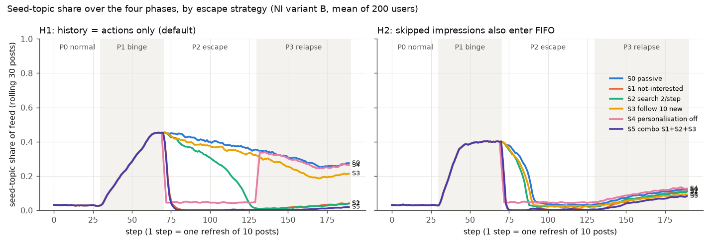

# Spot It Early, Get Out Cheaply? Detecting and Escaping Information Cocoons under X's Open-Sourced Feed Algorithm

COMP1110 Group Project — Project Plan

**Team members:** [Member A — Name, UID] · [Member B — Name, UID] · [Member C — Name, UID] · [Member D — Name, UID] · [Member E — Name, UID]

## 1. Problem Statement

**Everyday context.** Most of us scroll algorithmic feeds every day. After a few days of tapping on one kind of post, the feed can start to show little else. This is what Sunstein (2006) called an *information cocoon* (信息茧房) and Pariser (2011) a *filter bubble*. Whether such cocoons are common is contested: reviews find the classic filter-bubble story weakly supported (Ross Arguedas et al., 2022), yet on short-video platforms feed diversity does narrow for many users (Li et al., 2022; Piao et al., 2023). Regulators now act on the risk: China's 2022 algorithm rules require an option to switch personalisation off (Cyberspace Administration of China et al., 2021, Art. 17), a 2024 national campaign lists "information cocoons" as its first target (Secretariat of the Office of the Central Cyberspace Affairs Commission et al., 2024), and the EU requires a non-profiling feed option (European Parliament & Council, 2022, Art. 38).

**What is missing for users.** Two things an ordinary user would need are absent. First, users cannot *see* their own diversity: diversity measures need the platform's full logs, while a user sees only a few screens of posts. Second, evidence on whether user-side controls work is contradictory: a "not interested" button removed on average 88% of an unwanted topic's homepage recommendations for YouTube test accounts (Liu et al., 2024) but prevented only about 11% of unwanted recommendations for 22,722 real users (Ricks & McCrosky, 2022), and TikTok feeds relapse once users stop pressing it (Kaplan et al., 2026).

**A very recent opportunity.** Between August and September 2026, X published its production ranking weights, a diversity re-ranker and its filtering code (xAI, 2026; last updated 26 September 2026). For the first time, the mechanics of a major feed can be inspected end to end, including code that computes and logs feed-diversity statistics internally, which users never get to see.

**Research question.**

> *How early can a user notice — from what is visible on their own screen — that their feed is narrowing into an information cocoon, and how much effort does it take to escape and stay out, under the feed-ranking mechanisms that X open-sourced in 2026?*

In one sentence: *we test whether people can spot a cocoon early and get out of it cheaply, using X's published ranking rules together with real short-video logs.*

**Sub-questions.**
- **RQ1 Formation:** How fast does a feed narrow under X's disclosed ranking, and which of its mechanisms speed narrowing up or slow it down?
- **RQ2 Detection:** How well and how early do signals visible in the first ~20 posts of a session warn of narrowing, compared with platform-side measures that use all data?
- **RQ3 Escape and relapse:** How many steps and user actions do "not interested", searching, following new accounts and switching personalisation off need to restore diversity, and does the feed relapse afterwards?
- **Design goal:** Turn the answers into the design of a user-side "cocoon radar" that warns early and recommends the cheapest escape.

**In scope:** X's open-sourced ranking logic (as published in the repository); two public Kuaishou short-video datasets; topic-level (category) diversity; simulated users; a tool *design*. **Out of scope:** claims about how the live X service behaves; political content and effects on beliefs or well-being; building a new recommender algorithm; a working app; any data from real people or live accounts.

## 2. Computing and Data Science Connection

**Main project type: Hybrid.** The project has four parts with different types; B and C carry the technical depth.

| Part | Type | What it does | How it helps answer the question |
|---|---|---|---|
| A. Code analysis of X's feed | Algorithmic | Reads ~8 key files of the X repository and turns the pipeline into a *formula sheet*: final score = Σ weight × predicted action probability (e.g., like 0.5, reply 5, "not interested" −43.2); author-diversity decay (1−f)·dᵏ+f; out-of-network factor 0.75; a greedy determinantal point process (DPP) re-ranker (Chen et al., 2018); how "not interested" feedback flows (a 30-day time-to-live; no hard filter). It also lists what the code does *not* reveal. | Gives RQ1–RQ3 a real, inspectable mechanism instead of a textbook recommender, and defines the assumptions we must vary. |
| B. Real-log data analysis | Data analysis | Uses KuaiRec (7,176 users, 12.5 M plays, 41 categories; Gao et al., 2022b) and KuaiRand (27,285 users, 2.6 M logs incl. randomly inserted videos; Gao et al., 2022a) with pandas/scikit-learn: builds user-day diversity series; defines narrowing events against each user's own baseline *and* a resampling "noise-only" null; evaluates screen-visible early-warning signals with logistic regression, AUC/PR-AUC with user-level bootstrap confidence intervals, lead time and false-alarm rate; compares algorithmic vs random exposure. | Answers RQ2 on real users; measures the "information gap" between what users and platforms can see; supplies calibration targets for Part C. |
| C. Simulation of an X-like feed | Simulation / modelling | NumPy agent-based model. *States:* users with hidden topic preferences; items with topic, author and embedding; a FIFO history of each user's last M actions. *Rules per time step (one refresh of 10 posts):* retrieve ~150 candidates → predict action probabilities from history → score with X's weights → author diversity, out-of-network factor, optional DPP → user reacts (engage, skip, "not interested", search, follow). *Phases:* normal use → binge on one topic → escape strategy → relapse check. *Outputs:* the metrics below. | Answers RQ1 and RQ3 (which cannot be observed in public logs) and tests RQ2 where the true cocoon state is known. |
| D. Tool design | Development (design only) | Problem specification, wireframes, user flows, architecture (local-only processing of the visible feed) and must-have/nice-to-have features for a "cocoon radar". | Turns findings into something a user could act on. |

**Metrics.** For a window of posts with category shares pₖ: normalised entropy H̃ = −Σ pₖ log pₖ / log K (with a small-sample correction), top-category (or seed-topic) share, and relative diversity s̃ = H/H\* against the user's intrinsic diversity (Piao et al., 2023); see Kunaver and Požrl (2017) for this family of measures. Screen signals use only the first 20 posts: top share (S20) and number of distinct categories (D20). Escape metrics: *time-to-cocoon* (steps until seed share > 0.5), *escape cost* (steps and explicit actions until seed share returns near baseline), *relapse ratio* (share regained after the strategy stops) and *utility cost*.

**Preliminary results (pilots already run, to show feasibility).**
- *Real data:* in KuaiRand, algorithmic exposures are more concentrated than random ones (top-category share 0.31 vs 0.22 per 20 posts). In KuaiRec, sustained narrowing is rare once noise is controlled (0.26% of users drop ≥15% vs 0.02% expected by chance), while 7.9% of users become at least 10% more diverse. Screen-visible signals predict a 3-day narrowing event with AUC 0.78, against 0.85 for platform-side signals (gap 0.08, 95% CI 0.06–0.11); activity level alone reaches 0.83, so activity must be controlled in the final design.
- *Simulation:* an X-like feed calibrated to the KuaiRand concentration ratio (1.33 vs 1.45) forms a partial cocoon during a binge; the DPP re-ranker is the strongest brake. "Not interested" is the cheapest escape (about 4–8 refreshes, 10–22 taps), while switching personalisation off relieves the feed at once but the cocoon returns when personalisation is switched back on (Figure 1).

*Figure 1. Pilot simulation: share of the binge topic in an X-like feed across four phases for six escape strategies (200 simulated users). Left and right panels differ in one unobservable assumption (whether skipped posts enter the user's history).*

## 3. Literature and Background Review

**Do cocoons exist?** Sunstein (2006) and Pariser (2011) framed the worry; a Reuters Institute review finds limited support for strong filter bubbles and stresses that results depend on how exposure is measured (Ross Arguedas et al., 2022). Michiels et al. (2022) propose a testable definition — personalisation causing diversity to fall over time — which we adopt. On a large Chinese short-video platform, Li et al. (2022) followed 569,975 new Kuaishou users for a year: diversity rose for two months then declined, and watched content was less diverse than exposed content. Sukiennik et al. (2024) found the share of users in a bubble stays roughly constant while the depth of those bubbles changes, and Anderson et al. (2020) showed on Spotify that users who diversify do so by moving away from algorithmic listening. These studies use private logs and a platform's-eye view.

**Why cocoons form.** Simulations show recommender feedback loops homogenise consumption (Chaney et al., 2018; Jiang et al., 2019). Piao et al. (2023) explain cocoons with similarity-based matching and positive/negative feedback, and show that stronger negative feedback and user self-exploration push users back towards diversity; their model code is public. We reuse their relative-diversity measure and map their parameters onto X's mechanisms.

**Platform-side fixes.** Machine-learning work proposes new recommenders that "burst" bubbles, e.g., counterfactual reinforcement learning on KuaiRec (Gao et al., 2024) or controllable ranking (Wang et al., 2022), and diversity re-rankers such as DPP (Chen et al., 2018). These assume the platform changes its algorithm; user "controls" are simulated offline, not tested as real buttons.

**User-side escape and awareness.** Audits with scripted accounts show "not interested" can remove most of an unwanted topic on YouTube (Liu et al., 2024) and TikTok, but feeds relapse when users stop (Kaplan et al., 2026); a large study of real users found the same button far weaker (Ricks & McCrosky, 2022). YouTube audit data show bubbles can be burst by watching counter-content (Srba et al., 2023), and YouTube's sidebar "forgets" a partisan history within about 30 videos (Hosseinmardi et al., 2024). Feng et al. (2026) define a "bubble escape potential" in simulation. On awareness, an interactive visualisation raised 163 participants' awareness of their filter bubble (Nagulendra & Vassileva, 2014), but no study evaluates *how early and how accurately* a user-visible signal can warn.

**Data and code we build on.** KuaiRand's random exposures (Gao et al., 2022a) give a rare real "no-algorithm" baseline, and KuaiRec (Gao et al., 2022b) gives dense real preferences. X released older ranking code in 2023 (Twitter, 2023); its August–September 2026 updates add production parameter values, visibility-filtering code and a DPP diversity re-ranker (xAI, 2026). As of 28 September 2026 we found no study analysing the 2026 code from an information-cocoon perspective.

**Research gap.** Existing work (i) measures cocoons from the platform's side, never asking what a user can detect from their own screen and how early; (ii) studies escape either in black-box audits of YouTube/TikTok with conflicting results, or with textbook simulators, never inside a real platform's disclosed ranking rules; and (iii) rarely tracks relapse. Our question combines these gaps with a code release that is only weeks old.

## 4. Feasibility, Limitations and Ethics

**Data and tools are in hand.** KuaiRec (CC BY 4.0) and KuaiRand-Pure (CC BY-SA 4.0) are downloaded and loaded; the X repository (Apache-2.0) is cloned and its relevant mechanisms are mapped. Both pilots run on an ordinary laptop in Python: one simulation of 200 users × 190 steps takes about 10 seconds, and the full pilot (≈70 runs) took 12 minutes. Only ~8 files of X's code need close reading, and we have already turned them into a formula sheet.

**Main risks and how we handle them.**
- *X's model internals are not public* (the learned predictor, whether the DPP is switched on in production, how far one "not interested" tap generalises, whether skipped posts enter the history). The pilot shows these choices matter, so we treat them as experimental factors and report results as ranges rather than single numbers.
- *Real narrowing events are rare and noisy* in public logs. We compare every event rate with a resampling null, pool windows of at least ~90 posts, control for activity, and also report continuous diversity change.
- *Kuaishou 2020–2022 is not X 2026.* Real logs are used for general detection questions and calibration, not for claims about X.
- *Scope.* Must-have: Parts A–C for RQ1–RQ3 and tool wireframes. Nice-to-have: the full DPP sensitivity grid, testing detection rules inside the simulator against real-log noise, and a clickable prototype.

**What we will not claim.** We will not claim that our model reproduces the live X service, that cocoons change beliefs or harm well-being, or that our findings apply to all platforms. Findings about X are statements about its *published* mechanisms under stated assumptions.

**Ethics.** No human participants, surveys, sock-puppet accounts or scraping are involved: we use only public, licensed datasets that are already anonymised, published source code, and simulated users. The tool is designed, not deployed; its design keeps all processing on the user's device. If the project later adds any user testing, we will first obtain HKU ethics clearance. We report results in a way that informs users and regulators rather than helping accounts game X's ranking.

## 5. Timeline and Team Roles

| Week | Dates (2026) | Milestones | Lead |
|---|---|---|---|
| 1 | 28 Sep – 4 Oct | Finalise question; verify references; **submit Project Plan (4 Oct)** | A, all |
| 2 | 5 – 11 Oct | X formula sheet and assumption list final; noise-controlled outcome definitions; simulator refactored with tests; metric library | A, B, C, D |
| 3 | 12 – 18 Oct | Calibrate simulator to KuaiRand; RQ1 formation experiments; tool requirements | C, D, E |
| 4 | 19 – 25 Oct | **Interim meeting (20–24 Oct)**; RQ2 detection on real logs; tool wireframes v1 | B, E, all |
| 5 | 26 Oct – 1 Nov | RQ3 escape and relapse experiments with assumption factors; RQ2 inside simulator | C, D |
| 6 | 2 – 8 Nov | Results and figures; final tool design; **Interim Progress Log (4 Nov, individual)**; report draft | all; A edits |
| 7 | 9 – 15 Nov | **Final Report and Self-Reflection (15 Nov)** | all; A edits |
| 8–9 | 16 – 26 Nov | Slides and rehearsal; **presentation (17/19/24/26 Nov)** | E, all |

| Member | Main responsibility | Report sections |
|---|---|---|
| A | Project lead; X code analysis (formula sheet, assumption list); literature and regulation; final editor | Background, related work, mechanism analysis |
| B | Real-log analysis: KuaiRec/KuaiRand pipeline, noise-controlled events, detection evaluation, calibration targets | Data and RQ2 results |
| C | Simulator engineering: X mechanisms, calibration, reproducible code | Model description |
| D | Experiment design and statistics: RQ1/RQ3 factorial runs, confidence intervals, figures | RQ1/RQ3 results |
| E | Tool design (requirements, wireframes, architecture); presentation lead | Design section, slides |

## References

Anderson, A., Maystre, L., Anderson, I., Mehrotra, R., & Lalmas, M. (2020). Algorithmic effects on the diversity of consumption on Spotify. In *Proceedings of The Web Conference 2020* (pp. 2155–2165). ACM. https://doi.org/10.1145/3366423.3380281

Chaney, A. J. B., Stewart, B. M., & Engelhardt, B. E. (2018). How algorithmic confounding in recommendation systems increases homogeneity and decreases utility. In *Proceedings of the 12th ACM Conference on Recommender Systems* (pp. 224–232). ACM. https://doi.org/10.1145/3240323.3240370

Chen, L., Zhang, G., & Zhou, E. (2018). Fast greedy MAP inference for determinantal point process to improve recommendation diversity. In *Advances in Neural Information Processing Systems 31*. Curran Associates. https://proceedings.neurips.cc/paper_files/paper/2018/file/dbbf603ff0e99629dda5d75b6f75f966-Paper.pdf

Cyberspace Administration of China, Ministry of Industry and Information Technology, Ministry of Public Security, & State Administration for Market Regulation. (2021, December 31). *互联网信息服务算法推荐管理规定* [Provisions on the administration of algorithmic recommendation in internet information services] (Order No. 9). https://www.cac.gov.cn/2022-01/04/c_1642894606364259.htm

European Parliament & Council of the European Union. (2022). Regulation (EU) 2022/2065 on a Single Market for Digital Services (Digital Services Act). *Official Journal of the European Union, L 277*, 1–102. https://eur-lex.europa.eu/eli/reg/2022/2065/oj

Feng, D., Xu, Q., Wang, Z., Hua, C., Yang, Z., & Huang, Q. (2026). Quantifying the potential to escape filter bubbles: A behavior-aware measure via contrastive simulation. *Proceedings of the AAAI Conference on Artificial Intelligence, 40*(17), 14729–14737. https://doi.org/10.1609/aaai.v40i17.38492

Gao, C., Li, S., Zhang, Y., Chen, J., Li, B., Lei, W., Jiang, P., & He, X. (2022a). KuaiRand: An unbiased sequential recommendation dataset with randomly exposed videos. In *Proceedings of the 31st ACM International Conference on Information & Knowledge Management* (pp. 3953–3957). ACM. https://doi.org/10.1145/3511808.3557624

Gao, C., Li, S., Lei, W., Chen, J., Li, B., Jiang, P., He, X., Mao, J., & Chua, T.-S. (2022b). KuaiRec: A fully-observed dataset and insights for evaluating recommender systems. In *Proceedings of the 31st ACM International Conference on Information & Knowledge Management* (pp. 540–550). ACM. https://doi.org/10.1145/3511808.3557220

Gao, C., Wang, S., Li, S., Chen, J., He, X., Lei, W., Li, B., Zhang, Y., & Jiang, P. (2024). CIRS: Bursting filter bubbles by counterfactual interactive recommender system. *ACM Transactions on Information Systems, 42*(1), 1–27. https://doi.org/10.1145/3594871

Hosseinmardi, H., Ghasemian, A., Rivera-Lanas, M., Horta Ribeiro, M., West, R., & Watts, D. J. (2024). Causally estimating the effect of YouTube's recommender system using counterfactual bots. *Proceedings of the National Academy of Sciences, 121*(8), Article e2313377121. https://doi.org/10.1073/pnas.2313377121

Jiang, R., Chiappa, S., Lattimore, T., György, A., & Kohli, P. (2019). Degenerate feedback loops in recommender systems. In *Proceedings of the 2019 AAAI/ACM Conference on AI, Ethics, and Society* (pp. 383–390). ACM. https://doi.org/10.1145/3306618.3314288

Kaplan, L., Patel, D., Gerzon, N., Mislove, A., & Sapiezynski, P. (2026). When 'For You' isn't for you: Measuring user agency in TikTok's algorithmic feed. *Proceedings of the International AAAI Conference on Web and Social Media, 20*(1), 1175–1189. https://doi.org/10.1609/icwsm.v20i1.42688

Kunaver, M., & Požrl, T. (2017). Diversity in recommender systems – A survey. *Knowledge-Based Systems, 123*, 154–162. https://doi.org/10.1016/j.knosys.2017.02.009

Li, N., Gao, C., Piao, J., Huang, X., Yue, A., Zhou, L., Liao, Q., & Li, Y. (2022). An exploratory study of information cocoon on short-form video platform. In *Proceedings of the 31st ACM International Conference on Information & Knowledge Management* (pp. 4178–4182). ACM. https://doi.org/10.1145/3511808.3557548

Liu, A., Wu, S., & Resnick, P. (2024). How to train your YouTube recommender to avoid unwanted videos. *Proceedings of the International AAAI Conference on Web and Social Media, 18*, 930–942. https://doi.org/10.1609/icwsm.v18i1.31363

Michiels, L., Leysen, J., Smets, A., & Goethals, B. (2022). What are filter bubbles really? A review of the conceptual and empirical work. In *Adjunct Proceedings of the 30th ACM Conference on User Modeling, Adaptation and Personalization* (pp. 274–279). ACM. https://doi.org/10.1145/3511047.3538028

Nagulendra, S., & Vassileva, J. (2014). Understanding and controlling the filter bubble through interactive visualization: A user study. In *Proceedings of the 25th ACM Conference on Hypertext and Social Media* (pp. 107–115). ACM. https://doi.org/10.1145/2631775.2631811

Pariser, E. (2011). *The filter bubble: What the Internet is hiding from you*. Penguin Press.

Piao, J., Liu, J., Zhang, F., Su, J., & Li, Y. (2023). Human–AI adaptive dynamics drives the emergence of information cocoons. *Nature Machine Intelligence, 5*(11), 1214–1224. https://doi.org/10.1038/s42256-023-00731-4

Ricks, B., & McCrosky, J. (2022). *Does this button work? Investigating YouTube's ineffective user controls*. Mozilla Foundation. https://assets.mofoprod.net/network/documents/Mozilla-Report-YouTube-User-Controls.pdf

Ross Arguedas, A., Robertson, C. T., Fletcher, R., & Nielsen, R. K. (2022). *Echo chambers, filter bubbles, and polarisation: A literature review*. Reuters Institute for the Study of Journalism. https://doi.org/10.60625/risj-etxj-7k60

Secretariat of the Office of the Central Cyberspace Affairs Commission, General Office of the Ministry of Industry and Information Technology, General Office of the Ministry of Public Security, & General Office of the State Administration for Market Regulation. (2024, November 12). *关于开展"清朗·网络平台算法典型问题治理"专项行动的通知* [Notice on the "Qinglang" campaign against typical algorithm problems on online platforms]. https://www.cac.gov.cn/2024-11/24/c_1734143936205514.htm

Srba, I., Moro, R., Tomlein, M., Pecher, B., Simko, J., Stefancova, E., Kompan, M., Hrckova, A., Podrouzek, J., Gavornik, A., & Bielikova, M. (2023). Auditing YouTube's recommendation algorithm for misinformation filter bubbles. *ACM Transactions on Recommender Systems, 1*(1), 1–33. https://doi.org/10.1145/3568392

Sukiennik, N., Gao, C., & Li, N. (2024). Uncovering the deep filter bubble: Narrow exposure in short-video recommendation. In *Proceedings of the ACM Web Conference 2024* (pp. 4727–4735). ACM. https://doi.org/10.1145/3589334.3648159

Sunstein, C. R. (2006). *Infotopia: How many minds produce knowledge*. Oxford University Press.

Twitter. (2023). *the-algorithm* [Computer software]. GitHub. https://github.com/twitter/the-algorithm

Wang, W., Feng, F., Nie, L., & Chua, T.-S. (2022). User-controllable recommendation against filter bubbles. In *Proceedings of the 45th International ACM SIGIR Conference on Research and Development in Information Retrieval* (pp. 1251–1261). ACM. https://doi.org/10.1145/3477495.3532075

xAI. (2026). *x-algorithm* [Computer software]. GitHub. https://github.com/xai-org/x-algorithm
