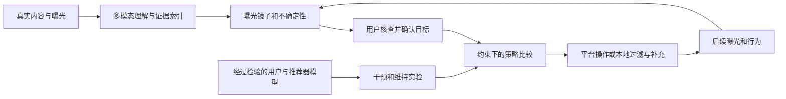

# Working Plan v3：帮助用户看清并调整短视频中的观点曝光

2026-10-03 · COMP1110 · 最终规划基线，替代 v2 的当前指引地位。配套 [Execution Plan v3](execution_plan_v3.md)、[扩展调研与选择依据](resource_review_v3.md)和[可行性检查](../context-recovery/plan_v3_feasibility.md)。这是研究与方案设计，不是实验完成报告。

**一句话：用可核查的多模态内容理解，帮助用户发现同一生活议题中反复出现的观点与理由；把用户确认的减少、保留和补充目标变成可执行的行动，再用真实数据与经过检验的动态模拟比较效果、损失和维持代价。**

v3 冻结问题、证据标准、接口和实验决策规则；模型版本与参数通过预定实验选定，结果可以否定候选方案。“最后一版 plan”不意味着事先宣布某模型最优或保证有效；后续结果与实施偏差写入实验记录，不再因新工具名称改变研究主线。

## 1. 从一个具体的生活问题开始

一个人开始考虑婚姻，于是关注彩礼、家庭分工和伴侣关系。他仍然会刷到美食、旅行、音乐；从类别饼图看，他的兴趣很丰富。但涉及婚恋时，推荐可能反复出现类似的冲突案例，以及“某一性别的人普遍如此”的解释。他逐渐觉得这些情况很常见，却不知道这种印象有多少来自内容的选择和重复。

他希望继续了解婚恋问题，也愿意接触不同意见，只是不想持续收到这种概括。然而，对一条视频点“不感兴趣”，究竟是在拒绝这个作者、这段剧情、这种叙事，还是整个婚恋话题？他也很难判断后续变化是否满足了自己的意思。

还有更早的一步：他可能尚未意识到自己反复接触的是同一种解释，甚至说不出该调整什么。一个有用的系统应当先帮助发现这种集中与重复，再帮助用户判断它是否值得改变，而不是等用户已经诊断好问题后才提供过滤器。

这是本项目的**问题情境**，不是声称已经从某个真实用户身上完整观察到了这条过程。我们的主要问题是：

> **如何帮助短视频用户发现自己在日常议题中持续接触的观点、理由和叙事是否过于局限，理解这种局限，并在保留有价值信息和自主选择的前提下，选择、实施和评估走出这种信息环境的办法？**

目标是跨议题复用的用户侧方法。婚恋／彩礼用于把抽象问题讲清楚，不必成为唯一或首先完成的开发案例；婚恋、育儿、教育与职业选择等生活情境都进入候选范围，多个议题共同检验定义与方法，并另留未参与开发的议题测试迁移。健康等证据不对称的议题可检验边界。具体选择按问题差异、证据条件与验证需要确定，不由哪批数据已经抽好来决定。

问题仍然有明确边界：关注短视频中影响日常判断的议题、同题内部的观点与理由，以及用户可采取的行动；不扩展为所有推荐系统问题，也不追求替用户判断一切观点的正确性。通用性来自同一具体任务在不同议题中的复用。

## 2. 为什么这是一个值得研究的问题

### 2.1 人需要信息作判断，但信息流不是现实的随机样本

从现实事件到用户看到的视频，至少经历了五次选择：什么值得被拍摄，谁愿意发布，平台保留和分发什么，排序把什么放到眼前，用户对什么停留和记忆。激烈冲突可能比普通相处更值得讲述；同一件事也可能被许多账号反复转述。

因此，“我的信息流里经常出现”不能直接推出“现实中经常发生”，多个视频也未必是多份独立证据。用户可能据此形成关于社会常态或群体的判断。这里的风险来自**取样过程与用户推断之间的不匹配**，不需要先假定平台有意操纵观点。

[Nguyen 对 epistemic bubble 与 echo chamber 的区分](https://philarchive.org/rec/NGUECA)提醒我们：相关声音缺席，与外部声音被系统性贬损，是不同问题。本项目首先处理曝光的可理解性和可调整性；并不假定增加反方内容就能化解身份对立和不信任。

### 2.2 兴趣集中可以合理，信息类别丰富也可以掩盖偏斜

连续看钓鱼、备考或某门专业课程，可能完全符合用户目的。对于证据高度一致的事实问题，强行配置一半反方也可能制造误导。因此，“窄”“单边”“有害”是三个不同判断。

反过来，一个人在很多内容类别之间切换，也可能在每个涉及社会判断的议题里，持续接触相同的理由和叙事。甚至正反立场各占一半，双方都用侮辱和以偏概全来表达，也未必提供了充分的信息。我们关心的是**当前判断需要哪些相关信息、实际获得了哪些、用户是否理解并认可这种选择**。

### 2.3 行为信号不能唯一表达用户的意图

停留可能意味着赞同、困惑、愤怒或单纯想看完剧情。同一次“不感兴趣”也可能对应多个不同意图。这是一个信息表达问题：多个意图被压缩成同一个动作，系统仅凭这个动作无法唯一还原用户想改变什么。

因此，用户控制需要同时考虑“减少什么”和“保留什么”。把整个婚恋话题删掉，可能减少了讨厌的叙事，也同时删掉他希望继续了解的内容。控制成功必须相对于具体意图评估。

### 2.4 短视频使这些问题更值得单独分析

连续播放、高频隐式反馈、低切换成本和多模态表达，让用户可以在很少主动选择的情况下持续获得内容。立场又可能藏在剧情、角色台词、配乐、字幕和反讽里，单看标题容易误判。

这些特点同时增加了测量和控制的难度。短视频仍然有搜索、关注和主动选择；问题应落在具体使用场景上。我们也不预设老年人或任何群体必然更容易被影响。

## 3. 把问题拆成可以检验的几层

基本链条是：

**内容供给与用户行为 → 系统选择和排序 → 实际曝光 → 注意与解释 → 对现实的判断 → 后续行为及反馈。**

| 层次 | 要知道什么 | 所需证据 |
|---|---|---|
| 曝光 | 某议题出现了哪些立场、理由、来源，持续多久 | 有时间顺序的曝光与可判定内容 |
| 自主控制 | 用户想减少和保留什么，操作后是否做到 | 明确意图、操作记录和后续曝光 |
| 社会认知 | 用户是否误判某类现象的普遍性或他人观点 | 独立的认知测量和合适参照 |
| 生活结果 | 信念、敌意、决策或行为是否改善 | 更长时间的真人研究与可信研究设计 |

本项目的核心在前两层。后两层说明问题为何重要，也为理想方案提出评价目标；它们不会被曝光熵或观看时长替代。

相应地，我们区分三个目标：**信息充分性**、**用户自主性**和**认知／生活结果改善**。满足用户选择不自动意味着信息更充分；让曝光更丰富也不自动意味着生活结果更好。报告应分别说明自己支持了哪一个目标。

这里还有一个必须正面处理的矛盾：**更强的观点过滤也可能加深茧房。** 不舒服的异议不等于误导，用户自己也可能只想保留赞同自己的声音。系统应展示调整对理由、限定和反驳的影响，允许减少、补充、探索或不采取行动。单向排除某种立场可以作为边界测试：控制服从了意图，却可能让观点范围更窄。它不是默认推荐的破茧目标，也不能仅凭“仍然保留了原话题”宣布信息充分。

本文把“观点信息茧房”作为需要分层识别的现象：在一个有明确含义的议题上，曝光持续集中于有限观点、理由或叙事，而用户难以察觉其选择性，或难以接触与判断有关的其他信息。系统首先能测的是前半部分的曝光结构；用户是否察觉、是否需要调整、是否因此受害，需要额外证据。集中、变化和缺少参照都应显示，不能合成一个未经验证的“你已被洗脑”分数。

“走出”也须操作化：相对于已说明的目标，恢复相关信息的可获得性、减少不希望持续占据曝光的模式，同时保留希望了解的内容；经过后续观察判断是否维持。一次熵上升、主题消失或把争议内容全部屏蔽，都不能单独算作成功。达到用户控制目标与改善认识分别评价。

## 4. 已有研究告诉了我们什么，还留下什么问题

### 4.1 曝光改变与态度改变之间没有统一、必然的效果

[Hartmann 等的综述](https://doi.org/10.1007/s42001-025-00381-z)涵盖 129 项研究，显示定义、方法和分析尺度存在重要差异。[Nyhan 等](https://doi.org/10.1038/s41586-023-06297-w)减少 Facebook 同立场来源曝光后，未检测到预定态度指标的变化；[Gauthier 等](https://doi.org/10.1038/s41586-026-10098-2)在 2023 年的 X 实验中，则发现开启算法流改变了部分政策和时事态度，且关闭的效果不对称。它们研究的平台、处理和结果不同，不能整理成“旧研究只看话题，新研究才看观点”的两派。

与本问题尤其相关的是两种更具体的错位。[Milli 等](https://arxiv.org/abs/2305.16941)发现，政治内容上的参与度排序与用户自述偏好可能不一致；但按偏好重排也可能增加同阵营曝光。[Brady 等](https://doi.org/10.1038/s41586-026-10536-1)在 Bluesky 实验中测到部分社会规范判断随排序改变，方向并非统一高估，自身参与行为也未显著改变。这些研究支持认真研究“用户看到什么”和“据此理解了什么”，不支持直接宣称中国短视频普遍强迫用户改变信念。

### 4.2 观点审计和按钮审计已经存在

[Pecher 等的 TikTok 研究](https://arxiv.org/abs/2603.20723)已经区分主题变化和同一主题内的立场变化。[Kaplan 等](https://arxiv.org/abs/2605.10690)、[Liu 等](https://ojs.aaai.org/index.php/ICWSM/article/view/31363)和 [Mozilla](https://assets.mofoprod.net/network/documents/Mozilla-Report-YouTube-User-Controls.pdf)已经研究去兴趣控制。它们的效果因推荐入口、话题、行为、测量单位和后续操作而不同，不能合并成一个平台按钮排行榜。

用户侧困难也有定性依据：[“They’ve over-emphasized that one search”](https://arxiv.org/abs/2504.13895)通过 14 名 TikTok 用户访谈记录了不想要的内容与控制困扰。它支持问题情境的合理性，但不提供中国用户的发生率，也不揭示平台内部机制。

### 4.3 项目贡献：问题分析与可跨议题使用的解决方案

[Draws 等](https://pure.tudelft.nl/ws/portalfiles/portal/150434223/978_3_031_28244_7_18.pdf)已有“立场 × 理由”的观点多样性思路，[RADio](https://arxiv.org/abs/2209.13520)也强调规范目标和参照。我们应借用这些概念，同时面对自然短视频的目标不明确、语境不完整和曝光稀疏。

[UCRS](https://arxiv.org/abs/2204.13844)已经提出提醒用户、表达控制指令并调整推荐的系统。因此“做一个通用的发现与控制工具”本身不能直接称为研究空白。它的类别／特征控制和可修改推荐模型的设定，为我们提供方法参照；我们进一步关注的是**同一议题内部的理由与叙事、内容判断的不确定性，以及无法直接访问平台模型时用户能够实际采取什么行动**。

本项目争取的贡献是：**针对用户难以察觉和调整同一生活议题内部观点局限的问题，设计并验证一套可跨议题使用的解决方案：从短视频曝光中提取可核查的命题、理由和叙事，识别持续集中及相对于明确参照的信息缺口，把用户的减少、保留与补充目标转化为可执行的干预，并检验它们在持续推荐反馈中的效果、损失与维护代价。** 多个案例共同开发通用方法，未见议题、来源和环境检验其适用范围；任何单一案例都不规定项目范围。

预期贡献具体落在三项：① 分析内容语境和标签不确定性对曝光诊断的影响；② 在保留相关信息的约束下比较干预及其持续代价；③ 检验方案跨议题复用时需要哪些定义、数据与适配。贡献可以来自新颖而重要的问题、具体情境中的分析发现，以及对用户有用的解决方案；不要求发明新算法、新指标或新的方法组合。已有完整方法若适用，也可以直接采用并在本情境中验证。

“通用”在这里是**通用任务与可替换的议题配置**，不等于任何视频都能理解、任何平台都能控制、所有领域都已验证。不能仅由“换成中文”“连成流程”或“第一次做”支撑新意；应与同题立场审计、可控推荐及用户侧工具逐项比较，并保留未覆盖的文献与验证范围。
### 4.4 本轮新增研究怎样改变方案

[SimTok](https://arxiv.org/abs/2504.08742)提供 LLM 用户与推荐器相互更新的框架，但用户接收的是标题等文本，主要测类别覆盖；不能原样回答我们的观点与理由问题。[KuaiSim](https://arxiv.org/abs/2309.12645)提供多行为响应和多轮环境，仍包含人为退出和状态转移假设。[LLM-Powered User Simulator](https://arxiv.org/abs/2412.16984)将语义偏好线索和统计预测结合，说明可以采用成熟混合方法，而不必让 LLM 随口生成所有行为。

[Yoon 等的模拟用户评价](https://aclanthology.org/2024.naacl-long.83/)把看似可信的模拟拆成可与真人数据比较的任务，发现偏好、请求和反馈可能失真。因此本项目将**模拟器验证与干预评价分开**：前者不过关，后者只能支持该假设世界下的机制解释。电影对话中的结果不直接推广到短视频；它提供验证思路。

[InteRecAgent](https://github.com/microsoft/RecAI/tree/main/InteRecAgent)已有“LLM 解析意图、调用检索与排序工具”的成熟设计；[Qwen3-VL](https://github.com/QwenLM/Qwen3-VL)、[Qwen3-Omni](https://github.com/QwenLM/Qwen3-Omni)和[多模态检索模型](https://github.com/QwenLM/Qwen3-VL-Embedding)提供超出标题的内容入口。这些进展支持更完整的方案，却不直接提供本项目的准确率、真实意图或因果效应。逐项源码、数据、许可和运行检查见配套调研。

### 4.5 方法选择的原则

从**需要改善的结果 → 所需证据 → 计算任务 → 广泛候选 → 同任务比较 → 采用条件**选择方法。已有清单、旧代码、CPU、旧 200 条样本均不定义上限；开源方法、可获得模型服务、成熟软件及必要的自建模块都可进入候选。LLM/VLM/Agent 是主方案候选，无须先证明规则失败才可使用。

“最好”指本任务中的正确性、覆盖、证据支持和最终目标达成，不等于参数最多或组件最多。内容检索、来源核查、时序测量、用户意图、策略选择、模拟器和真人评价全部接受这一标准。简单方法可以胜出；**题目新颖不要求方法原创**。候选比较有预定范围、开发集与独立测试，不无限试模型后挑最好的一次。

## 5. 三个问题与完整用户流程

| 问题 | 要做成什么 | 必须允许的失败结果 |
|---|---|---|
| Q1 看清 | 发现某议题中持续重复的观点、理由与来源，展示证据、缺口和参照 | 无足够语境／轨迹时无法诊断；合理专门兴趣无需调整 |
| Q2 调整 | 理解用户目标，保留需要的信息，减少不希望反复出现的模式，补充相关理由 | 当前供给、平台接口或误判使目标不可实现；服从过滤指令也可能加深封闭 |
| Q3 维持 | 比较持续操作、停止操作和自然行为变化后的效果及代价 | 只在某类用户／平台假设下有效，或者所有可用策略都不稳健 |

用户流程：**导入或观察 → 发现议题 → 回看依据与参照 → 决定是否调整 → 确认减少／保留／补充 → 选择行动 → 复查**。用户可以主动指定议题，也可以从系统提出的线索进入。

仿真为行动提供条件化证据，不给真实用户承诺具体逃离时间。平台推荐、工具处理后实际可见的信息、外部补充材料三条流分别记录。

## 6. 内容层：理解视频、找到理由、追溯证据

### 6.1 共用表示

每个视频可关联多个命题，每个命题记录：**对象与条件、发言主体、立场、理由、叙事、证据片段、来源关系、未知原因**。支持、有条件支持、反对、混合、未表态、无关和语境不足区分；理由可多标签、有开放项。角色台词不是作者认同，情绪不是立场，相似标题不是同一事件。

核心数据合同分为内容证据、曝光事件、目标与行动三张逻辑表；另存来源／引用关系和版本记录。原始材料、人工判断、模型输出、用户认可、仿真真值不可混列。任何报告中的标签可回溯到具体材料，并在更正后重算。

### 6.2 检索与议题发现

主候选是词法与语义混合检索，加适用的重排；比较 BGE 系列、Qwen3 Embedding/Reranker 等已有模型。在可获得视频上，额外比较直接多模态检索，检查是否找到标题遗漏的相关内容。聚类和 LLM 用于提出候选议题及理由，不把聚类自动命名成可靠命题。

判断检索效果不仅看命中样例，还要抽查未命中内容、测漏收和误收。议题选择覆盖条件表达、引用／剧情、价值取舍、来源重复、证据不对称等困难；至少两个议题共同开发，至少一个完整议题留出。旧彩礼样本只是可复用数据，既非必选议题也非规模上限。

### 6.3 多模态理解与按需取证

主方案比较三条成熟路线：文本 LLM 处理标题和 ASR；VLM 处理视频／关键帧加同步转录；支持音频的视频模型联合处理声音与画面。Qwen3-VL + ASR 和 Qwen3-Omni 是已检查接口的候选；后续可选模型服务，但按同一输入条件与任务检验。ASR、字幕 OCR、说话者和时间定位分别承担明确工作，不要求每条视频机械经过所有组件。

固定流程与按需取证 Agent 都进入开发比较。Agent 可因角色不明而补看前后片段，因字幕不清而取高分辨率画面，因事实主张而查来源；必须保存调用记录和证据。停止条件是证据足够、无可用新材料或达到任务预算，不靠增加推理文字宣布确定。

采用与拒答由独立校验决定：分别看立场、条件、理由、发言主体和依据支持，重点检查会导致误删或错误提示的错误。不能把“JSON 合法”“几个模型同意”“自称很有把握”当语义正确。模型辅助标注与独立人工金标准分开。

### 6.4 理由与来源

用可查询的关联表起步，成熟抽取、检索和去重即可；需要多跳追溯时再采用图结构。区分一个事件被十个账号复述，与十个独立事件；找不到来源时保留未知。补充目录围绕用户判断所需的理由、条件与证据建立，不只寻找反方立场。

检索 Agent 读取实际来源并返回可定位段落，人工审计来源是否真的支持所写内容。争议与证据强弱分别展示；不得凭空生成“另一边的事实”制造平衡。目录总是不完备，因此“缺少理由”只相对明确版本的目录或任务定义成立。

## 7. 镜子：让曝光结构可理解，而非制造一个诊断分数

报告状态为：`覆盖条件、议题量、立场分布、理由覆盖、叙事重复、来源关系、时间变化、参照差异、不确定性`。并列曝光次数、不同视频与不同来源线索；观看时长可单列为注意代理，不当认可程度。

参照分别命名：用户确认目标、个人过去、同期研究样本、可追溯理由目录、已知候选供给、实验中的其他策略。它们回答不同问题，没有哪个自动代表社会真实比例或健康标准。没有合适参照就展示观察，不强行给异常评分。

若确认相关的 `R` 条里有 `S` 条支持、`U` 条未知，未知导致的支持比例范围是 `[S/R,(S+U)/R]`；`R=0` 不计算。这不是置信区间，不包括检索漏收、相关性未知或已回答项误判。后几种误差通过独立审计、分层重算及敏感性分析另行传播。

使用窗口统计和可解释的分布距离；需要变化点检测时与简单持续窗口法比较。对多标签理由逐项分析，不将重叠比例硬塞进单标签 JS 散度。已发生的曝光序列不直接照搬搜索排名折扣。

验证单位是整条序列：长期集中、突然变化、供给单边、合理专门兴趣、重复转述和稀疏未知都进入检查。阈值在开发轨迹选定；测试报告整段观察期的误报、检出、延迟与拒答，处理反复查看和多个命题带来的误报。自然轨迹不足时说明无法确认真实个人性能。

## 8. 干预：把表达清楚的目标变成能够执行的行动

LLM 将自然语言整理为 `减少 T、保留 K、补充 A、例外、允许动作、预算、期限`，展示例子让用户确认。重叠或冲突进入待澄清项；预测观看偏好不能填入“用户已经同意”。设计任务用于离线检验，不冒充匿名用户的真实意愿。

策略分三层评价：

| 层次 | 能做的事情 | 能支持的结论 |
|---|---|---|
| 用户现有控制 | 负反馈、作者屏蔽、搜索、关注、平台实际提供的设置 | 在指定能力和响应机制下的调整潜力 |
| 用户侧工具 | 证据镜子、本地可见流过滤、来源检索、补充阅读、操作辅助 | 本地信息环境改善；不能自动称平台已经改变 |
| 可修改推荐器的研究上界 | 意图约束重排、理由覆盖优化、UCRS 类控制 | 若平台提供更细控制，可以多改善什么；不是用户现有能力 |

先以可执行性、保留和证据约束筛选，再比较目标残留、理由覆盖、误删、未知删除、操作与额外阅读。有限策略枚举、MMR 去冗余或贪心覆盖都是成熟候选；不用单一总分隐藏取舍。复杂序列策略只有在明确的长期收益问题上进入比较，强化学习不是预设要求。

行动 Agent 负责澄清和调用工具，约束、指标及策略计算由程序执行。固定工作流与 Agent 在相同任务下比较；Agent 若没有改善端到端表现就不采用。工具读入的网页、视频字幕是待分析数据，不能改变用户已确认目标或工具权限。

控制成功须同时满足：目标表达降低、议题与所需信息仍可获得、补充有实际依据、代价可接受、效果经后续观察维持。仅删除整个议题、补入无关内容稀释占比、把难例转成未知，都不算成功。符合过滤指令与信息充分性分开评价。

## 9. 动态仿真：推荐器、用户和干预工具相互独立

**动态仿真是核心工作。** 目标是解释干预何时有效、为何失效和维持需要什么；既不复刻一个无法访问的生产平台，也不把人设写得详细当作真实性验证。

### 9.1 五个独立对象

1. **内容世界**：真实多议题内容与独立核验标签为主；构造材料只检验受控机制并明确标识。供给可本来单边，不能默认所有缺失理由都能在平台找到。
2. **推荐器**：透明反馈模型作机制对照，训练的成熟序列／多反馈排序模型作主要环境，固定 X 公开模块提供可检查机制条件。探索、记忆、负反馈泛化和训练更新各自明确。Phoenix nano 的合成跑通不等于真实 X。
3. **用户模型**：下述 U0–U3 产生自然反应、记忆与是否执行建议；行为倾向和反思目标分开。
4. **干预助手／策略**：只读用户侧可见内容、观测历史和确认目标，不能读用户隐藏状态、未来反馈、完整供给真值或推荐器内部参数。
5. **独立评价器**：以冻结的人工／构造真值和任务规则评价曝光、保留与代价；不得以生成行为的同一模型自评作为唯一裁判。

一步为：候选召回与排序 → 平台分发记录 → 工具处理／补充 → 用户实际接触与反应 → 平台收到的信号更新 → 下一轮诊断。外部阅读不自动写回平台；被本地隐藏的视频是否触发曝光／划走须显式设定。

### 9.2 用户模拟的主候选与对照

| 模型 | 作用 | 采用条件 |
|---|---|---|
| U0 透明随机／规则模型 | 手工核查状态、机制和极端边界 | 规则有明确来源或声明为假设，不宣称拟合真人 |
| U1 数据驱动模型 | 从真实历史估计可观察的多行为响应；KuaiSim 类结构是候选 | 独立用户／时间上的预测与校准通过，退出及多步转移假设单列 |
| U2 LLM/VLM Agent | 理解具体理由、条件、内容吸引力、自然语言目标及行动选择 | 真实历史前缀驱动；验证行为分布、重复一致性及提示敏感性，不以人口学人设代替个人证据 |
| **U3 混合模型（优先检验）** | LLM/VLM 给出有依据的语义特征，统计响应模型结合历史估计概率，再采样行为；语义记忆处理复杂目标 | 与 U1/U2 同输入比较；融合／校准只用训练和开发数据；未证明更好前不宣布胜出 |

U3 不把 LLM 的“70% 想点赞”直接当概率。可采用成熟特征融合或受约束集成，选择以 Brier/log loss、行为覆盖及多步稳定性为准；模型解释只作可审计线索。文献提供方法先例，已有仓库缺失资产时允许按公开规格适配实现。

观看不等于赞同，用户希望减少某种表达也不等于完全不被它吸引。自然反应不接收“你要形成茧房”的任务；干预建议可能被忽略、延迟执行或放弃。真实日志没有确认目标与遵从记录时，这些参数是情景假设，不伪装成拟合值。

### 9.3 先验证环境，再在环境里评价干预

- **一步验证**：按用户与时间隔离，比较行为基率、区分度、概率校准、用户异质性与冷启动；稀有反馈单独报告。
- **多步验证**：在观测支持范围比较行为连串、重复、会话长度和分布漂移。历史前缀的下一步预测通过，不代表改变推荐策略后的长期反应已验证。
- **Agent 特有检查**：改写无关提示、重复运行、改变模型家族；检查过度服从、正向反馈偏置和记忆失真。不得将未来日志、评价答案或助手预期效果写入人设。
- **跨环境验证**：策略开发与最终评价的用户模型／平台参数分开，检查策略排序是否翻转。共享训练数据或同模型家族的一致性不是独立现实证据。
- **证据不足的边界**：未观测动作、观点改变、外部阅读对行为的影响分别作敏感性范围。没有真人材料就不能宣布心理反应可信。

### 9.4 动态实验与成功标准

比较不额外操作、负反馈、约束过滤＋真实来源补充、反馈＋搜索／关注及必要的组合；整话题删除作保留损失对照，平台上界单列。先允许自然反馈形成集中，也检查没有形成集中、供给单边和合理兴趣的世界，不强制每个用户入茧。

干预后比较继续执行、停止执行且自然倾向不外加改变、停止并增强原目标内容参与。后者是明确外加的行为情景，不能叫算法自行复发。用户改变目标时从变更点重新评估，不记成旧策略失效。

报告连续若干冻结窗口联合达标的概率、达到目标所需曝光步数、保留损失、理由新增、未知影响、操作与阅读负担、维持与反弹；主报告同时含绝对量和同议题比例。未达标保留为未达标／右删失；复发分母只含先达标者并同时展示全体轨迹。随机世界 seed 与 Agent 采样分开；模拟步数不换算成真人分钟，模拟效用不命名为真实满意度。

## 10. 真实资源怎样相互补充

ShortVideo 连接真实视频语境与部分行为；KuaiRand 提供曝光、多反馈与随机插入；KuaiRec 提供有限候选池近完整历史反应；KuaiSAR 提供搜索和推荐转换。它们通过共用字段与问题对照协作，**不按匿名 ID 跨源拼接成一个不存在的完整用户**。

KuaiRand 的随机插入不等于关闭个性化。离线反事实评价先检查行为策略概率、支持范围、历史混杂和目标定义；Open Bandit Pipeline 的成熟估计器不能补出缺失的识别条件。KuaiRec 的观看比率也不是新顺序下的真实反应或福利。KuaiSAR 查询／标题的哈希形式限制语义解释，必须实际检查字段后使用。

X 源码、真实日志关联和已发表平台审计各提供一种证据：机制可能如何工作、样本里观察到了什么、他人在特定设计下测到了什么。它们不能合成“我们的快手数字孪生已经校准”。选择关键原研究可复现的结果作方法核对，保留零结果和冲突。

## 11. 理想能力与项目最终交付

| 理想能力 | 最完整的方案 | 当前必须说明的差距 |
|---|---|---|
| I1 完整曝光 | 本人授权的连续、入口明确的曝光及操作 | 公开日志可能抽样、缺上下文，不能补造完整 feed |
| I2 完整内容 | 音画、字幕、角色和来源的联合理解 | 已取得媒体不等于已正确理解；模型、语境和证据均可能不足 |
| I3 明确意图 | 真人理解报告后确认目标与例外 | 设计任务／Agent 目标不等于匿名用户真实愿望 |
| I4 持续镜子 | 可更正、可复查的个人报告 | 自然轨迹不足时只能验证组成模块和模拟序列 |
| I5 有效行动 | 平台内细粒度控制与用户侧补充 | 平台接口不一定支持语义控制；本地效果不能冒充平台效果 |
| I6 可信长期比较 | 控制实验加经现实验证的动态模型 | 无平台随机试验不能保证因果效应；仿真始终带假设 |
| I7 人的收益 | 理解、自主性、负担，及另行测量的认知结果 | 没有真人研究就不能证明用户获益；理解任务也不证明长期信念改善 |

最终交付围绕同一条主线：**可追溯的多议题内容与模型评价、带证据的曝光报告、可执行的干预及取舍表、经过验证或明确限定的动态实验、跨议题检验与用户任务设计**。技术深度集中在内容到证据、约束干预和反馈仿真；其他模块为它们服务。

可选工具是个人信息流助手：导入本人记录、回看证据、更正标签、确认目标、查看补充材料与操作说明、再次导入复查。先可用报告／notebook／本地交互载体承载，不要求 app、手机平台接入或上线。真人评价优先检验能否看懂、纠错和选择适合行动；具备参与者与同意条件时实施，否则交付完整协议并明确未完成。

课程是 computing & data science 的分析、建模与设计项目。代码和工具帮助核查思想，不取代论证；课程压缩稿另按 4–6 页要求制作。工作量与技术难度不预先削弱设计，资源不足的实施差距在 Execution v3 中逐项登记，不悄悄改题。
