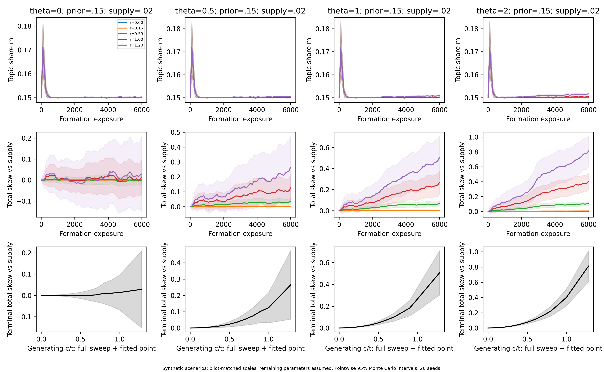

# Appendix B. Simulation and detection details

Technical details supporting the simulation in Section 5.2 and detection in Section 5.3.

## B.1 Model, calibration and full parameter record

The L4-aligned main uses the reference-labelled response +0.12 from Section 5.1 and produces weak narrative skew. The earlier +1.13 pilot remains an upper scenario; none of its stored results is deleted. These are synthetic consequences of response inputs, not an independent measurement of an online platform or users' beliefs. We use six homogeneous groups: A (the target narrative), B (other videos within the topic), and four outside topics. Recommendation is a weighted softmax, π(i) ∝ wᵢ exp(u·vᵢ/τ), where w supplies the initial topic and narrative shares. Topic items share coordinate t. Their attribute coordinates are c(1−s) for A and −cs for B, where s is A's assumed supply share. Thus B is not coded as strongly anti-A, and the supply-weighted attribute mean is zero.

An exposed item is completed with probability σ(−1+1[topic]+θ1[A]); completion adds ηvᵢ to the user state. Forgetting acts at every organic exposure. Each state coordinate is clipped to eleven times the largest absolute item coordinate. This allows ten calibration injections without clipping and prevents unbounded scores. Coordinatewise clipping preserves attribute memory when topic coordinates saturate, but it is an assumed policy, not an identified OneRec mechanism. There is no within-group item heterogeneity or noise.

We compute topic exposure m=π(A)+π(B) exactly. Using the supply reference, skew is V_sup=log(π(A)/π(B))−log(s/(1−s)). This is the **total skew of Section 3.2**, not platform-referenced personal V. These runs cannot separate global amplification from individual personalization. Intervention changes use the same fixed supply reference. Twenty independent seeds per setting give pointwise 95% Monte Carlo intervals for means, using mean ±2.093·SD/√20; these intervals do not represent uncertainty about real platforms.

| Quantity | Inputs or scan | Evidence status |
|---|---|---|
| Topic injection contrast | Log topic-exposure ratio +0.70, retained in issue #21 | Earlier calibration target retained; L4 separately reports strong topic log-odds responses, a different quantity |
| Attribute injection contrast | Main +0.12 (SE .07), DeepSeek labels; zero lower; old +1.13/+0.65 retained | Section 5.1, l4_onerec_v0.json and l4_null.json; main is not distinguished from pseudo-narratives |
| Positive NI response | L4 about 40% of watched-column topic response; historical 78% of neutral-title response | Different denominators; prior .39–1.17 sensitivity numerically includes about .40, not a common identified coefficient |
| Calibration sensitivity | Each target separately ×0.5 and ×1.5 | Assumed stress tests, not a joint confidence region |
| Effective scale and units | η=τ=1; t≈0.263; new main c≈.1095, c/t≈.4170; old upper c≈.336 | Unit convention plus moment fit; only ηt²/τ and ηc²/τ are identified |
| Initial topic share | 10%, 15%, 20%; main case 15% | Heavy-viewer scenarios, not the typical RecIF user |
| A supply within topic | 2%, 10%, 50%; main case 2% | Assumed supply; exposure prevalence does not identify it |
| Generating c/t | 0–1 in 0.1 steps, plus 0.15, 0.59 and each fitted ratio | Scenario scan; embedding contrast anchors are not fitted generating coefficients |
| Preference and memory | θ=0, 0.5, 1, 2; forgetting 0.0002, with ×10 sensitivity | Assumed response and memory rules |
| Horizon | 6,000 formation, 1,000 active, 2,000 follow-up exposures | Assumed experimental duration; no elapsed-time conversion |
| Output classifier | Main-grid benchmark: recall 0.8, false-positive rate 0.02; v2 sensitivity: 0.8, 62/495 | Benchmark assumed; v2 rates are cross-model agreement estimates, not gold-standard accuracy |

Moment matching uses a fixed synthetic 15% topic-prior context: ten mean-topic injections versus ten outside injections split 3/3/2/2 across outside topics, and ten A versus ten B injections for the attribute contrast. It matches aggregate response targets, not the actual videos or histories used in OneRec. The new main ratio is .4170. At θ=2 it gives V_sup=.05130 with pointwise seed-mean 95% interval [.03892,.06368]. This interval conditions on the positive .12 input; it cannot establish empirical narrative contrast beyond null.

The random pseudo-narrative mean is .09229, SD .12658 and range [−.18140,.24450]. Descriptively subtracting its mean from .12 gives .02771; this is not a statistically identified positive effect. The existing ratio=.20 grid point (case 17) has achieved response .02760 and V_sup≈.01089; ratio=0 (case 14 and the new independent zero-limit check) gives zero skew. These are near-null sensitivities, not a confidence interval. The historical group ratio 1.280 and conflict ratio .971 and all 262 original scenarios remain available. Their input-target sensitivities are one-at-a-time, not joint confidence regions.

The issue #21 rerun holds supply=.02, prior=.15, all four θ values and 20 seeds each, with the same 6,000/1,000/2,000 horizons. It records 9,760 formation snapshots and 3,840 selected strategy states/endpoints for the +.12 and zero-limit runs. S0 and S1a/S1b/S3/S5/S6 share initial states and random streams. Benchmark filtering remains recall=.8/FPR=.02. Its large output effect is a separate mechanism, not evidence that narrative-specific feedback or natural formation is strong.

The earlier formation figure is preserved as upper-scenario evidence:



The figure's fitted group curve uses the old +1.13 input; it must not be interpreted as the L4-aligned main.


## B.2 Strategy implementations and effort

| Arm | Implementation |
|---|---|
| S0 | Continue natural exposure and completion. |
| S1a | On A replace completion with a negative unit update. |
| S1b | On A replace completion with a positive 0.5 update; separately fit the positive NI response. |
| S2 | On A suppress completion updates. |
| S3 | Always complete encountered B. |
| S4 | Add one completed B every ten organic exposures. |
| S5 | Once remove surviving A contributions, with their historical coordinate-clipping factors; not counterfactual replay. |
| S6 | Expected class-dependent output thinning, normalized back to one; natural feedback then uses the filtered distribution. |
| S7 | Remove all topic output: m=0, skew undefined. |
| S8 | Serve using the fixed mean terminal state of 80 users with equal-sized theta groups; mean state is not mean softmax exposure. |
| S9 | Reset the state once. |

The arms share initial formation states and coupled random numbers. After 1,000 active exposures, output controls are removed before the next natural draw. Follow-up runs for 2,000 exposures with original preferences. Effort counts actions, not equal human time: bulk deletion/reset count once; S4 adds 100 viewed items; S3 acts on every encountered B, including cases that might naturally complete. Perfect identification of A is assumed for feedback/deletion. Filtering quality is tested separately. Ledger deletion can overshoot toward B.

We record two half-lives: the first follow-up step halving the initial reduction relative to pre-intervention skew, and a separate half-life of improvement over matched S0. No initial reduction has no defined half-life. A reduction not halved by the horizon is right-censored; its time remains missing, with explicit flags. Conditional averages of observed half-lives must not treat censored times as 2,000.

## B.3 Local contrasts, filtering and the NI fit

For the homogeneous centred vectors, Proposition 1 gives an A update contrast c²(1−s) and a B update contrast −c²s, before clipping. At s=.02, B's magnitude is 1/49 of A's. The negative B sign predicts local mitigation, not necessarily reversal of accumulated skew while natural A feedback continues.

Proposition 3 describes filtering without refill. Our output distribution additionally renormalizes: if L=m[p·TPR+(1−p)·FPR], then m'=(m−L)/(1−L), B retention is (1−FPR)/(1−L), and the direct skew change remains log[(1−TPR)/(1−FPR)]. The stored instantaneous sensitivity uses all 20,960 formation endpoints and two classifier cases (41,920 rows). It is distinct from the 1,000-exposure dynamic S6 outcome. A supplementary dynamic rerun uses only the two fitted main cases (15,360 seed snapshots), not the full 262-case grid. Baseline S0/S6 values are checked against merged R3.

The main-grid S1b=.5 preserves the assigned strategy. Separately, solve for an NI pulse coefficient whose topic-response contrast is 78% of the neutral-mention contrast, using the same capped injection model. The coefficient is .770619, not .78. Target ratios .39/.78/1.17 are scanned; achieved responses and residuals are retained. A positive pulse need not outperform natural completion cumulatively when it replaces a larger expected completion update.

The L4 estimate of about .40 is relative to the watched column, whereas .78 is relative to a neutral column title. The prior ±50% range includes .39, so it covers .40 numerically, but it is not a direct re-estimate on the same denominator. The +.5 update arm is retained; neither response ratio should be substituted mechanically as an update coefficient.

## B.4 Detection approximation (Proposition 6)

With recall α and false-positive rate β, q=β+(α−β)p. For odds multiplier r, p_u=rp₀/(1−p₀+rp₀). Equal user/reference samples each need approximately

$$n=\frac{(z_{0.95}+z_{0.8})^2[q_u(1-q_u)+q_0(1-q_0)]}{(\alpha-\beta)^2(p_u-p_0)^2}.$$

Round n upward, then divide by the topic exposure rate and round upward again. Both newly collected arms double the total. The main reference is DeepSeek v2: five positives among 500 exposure-weighted samples, p₀=.01. Qwen relative to DeepSeek has TP=4, FP=62, FN=1, TN=433: α=.8, β=62/495. These are cross-model agreement rates, not human gold-standard accuracy. The calculation treats them as known; it does not propagate the substantial uncertainty from five reference-positive samples. Historical v0/v1 and v5 pilot prevalences remain version-labelled sensitivity inputs. Independence, normal approximation and reference comparability are additional assumptions; no sequential alarm or elapsed-time estimate is tested.

## B.5 Numeric provenance and reproduction

The full run generated 1,278,560 formation and 1,168,640 strategy snapshots. The public gzip package retains every seed endpoint and complete summaries, with intermediate raw traces only for plotted cases: 65,520 formation and 971,520 strategy snapshots. There are 461,120 half-life records covering both reference definitions. Cadence, cases, compression, raw/compressed hashes and small exact numerical-source snapshots are retained in the metadata and packaging manifest. Full uncompressed data stays in a local archive outside Git. Monte Carlo intervals concern seed variation, not uncertainty about platform effects or calibration inputs.

Reproduce from the repository root:

```powershell
python analysis/v6_simulation/calibrated_run.py
python analysis/v6_simulation/ni_calibration.py
python analysis/v6_simulation/package_results.py
python analysis/v6_simulation/calibrated_audit.py
python analysis/v6_simulation/detection_revised.py
python analysis/v6_simulation/filter_v2_instant.py
python analysis/v6_simulation/filter_v2_dynamic.py
python analysis/v6_simulation/verify_report_evidence.py
python analysis/v6_simulation/l4_main.py
python analysis/v6_simulation/verify_issue21.py
```

Use a new local archive directory when changing the old grid's inputs; the packager protects existing full data. The first commands reproduce the preserved upper/comparison grid; l4_main.py separately reproduces the current L4-aligned main without overwriting it. New files are l4_main_calibration.csv, l4_main_summary.csv, l4_main_formation.csv.gz, l4_main_endpoints.csv.gz and l4_main.meta.json. Calibration sources are Section 5.1 and analysis/v6/results/l4_onerec_v0.json, l4_null.json; their exact hashes are recorded. Legacy inputs remain calibration_targets.csv, ni_response_calibration.csv and v2_detection_inputs.json. The current main's +.12 target remains uncertain relative to the null distribution; a positive toy outcome is not evidence that L4 established narrative amplification.
