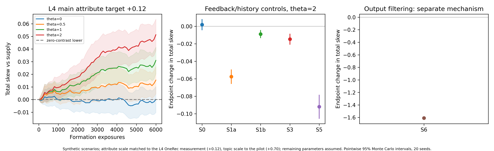
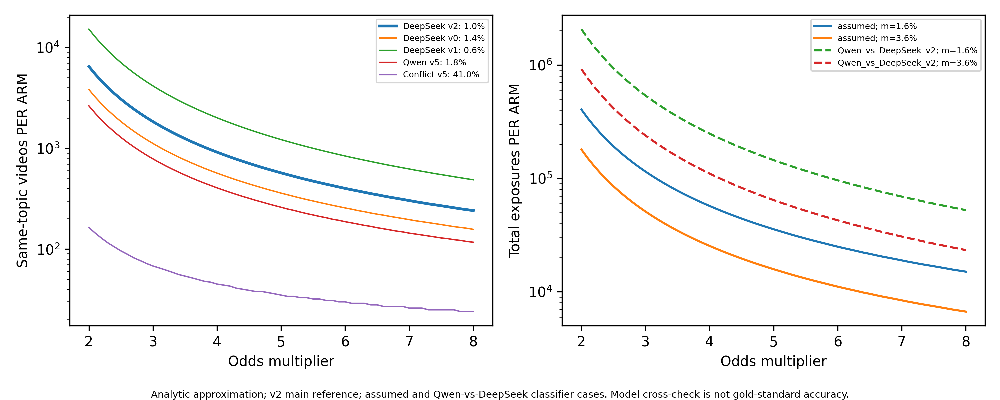

# 5 Case Study: Gender and Relationships (RQ2, RQ3)

<!-- 5.1 by Li Yitong, 2026-11-07. Sources: analysis/v5_feasibility/results/onerec_{probe,ni_header,viewpoint_ctrl}.json (v5 pilot, Qwen labels) and analysis/v6/results/l4_onerec_v0.json, l4_null.json (DeepSeek labels). 5.2 and 5.3 are Xu Ruicong's. -->

This section asks how a feed tilts and how a user can undo it, for the narrative of our case study: videos that attach a negative label to a whole gender ("group-label" videos, Section 4.3). We first measure how a recommender trained on real logs responds to user actions (5.1), then use those responses to set the scale of a transparent simulation of formation and escape (5.2), and finally ask whether a user could notice the tilt (5.3).

## 5.1 Measurements on OneRec

**Set-up (measured).** OneRec-1.7B is a recommender released by Kuaishou's team and trained on the RecIF logs (Zhou et al., 2025). It reads a user's history as text, with each video written as a three-part semantic ID, and generates the IDs of videos to recommend. We used it in two ways. In the *conditional* task, the history is split into sections (videos the user watched to the end, liked, marked "not interested", and so on); in the *video* task, it is one long sequence. For each of 30–50 users from the benchmark test set, whom the model never saw in training, we changed the history in one controlled way and computed the exact probability that the model recommends each video in a fixed candidate set. From these probabilities we read the two quantities of Section 3: the share of issue videos among the candidates (topic share $m$), and the log-odds of group-label videos against other issue videos of the same genre ($V$). Videos used to change the history were never among those used to measure the response.

**Result 1: the topic responds strongly.** Putting 10 issue videos in the "watched to the end" section raised the share of issue videos in the recommendations from 2.6% to 5.7%, against 2.8% when the 10 videos were off-issue; all 40 users moved in the same direction (pilot, Section 4 labels by Qwen). With issue labels from DeepSeek the effect has the same size: the log-odds of issue against off-issue candidates rose by 0.9–1.1, for 90–96% of 50 users.

**Result 2: "not interested" works in the wrong direction.** Putting the same 10 issue videos in the "not interested" section *also* raised the issue share, to 4.0% (40 of 40 users), and the marked videos themselves became more likely to be recommended. With DeepSeek-labelled videos the rise in log-odds was 0.33–0.45 for 96% of users, about 40% of the effect of the "watched" section. Swapping the section title showed why: three negative titles ("not interested", "disliked", "blocked") had almost the same effect as each other, about 78% of a neutral title ("here are some videos"). The model has learned that a video in the prompt is a clue to the user's interests, and has learned little about what the title means. A check on the logs ruled out the other explanation, that users mark only content they were already close to: in the logs, a "not interested" mark goes with *lower* later interest in the issue (odds 0.61–0.77 times). Sequence models trained only on logs are known to be insensitive to negative feedback (Y. Wang et al., 2023).

**Result 3: OneRec does not separate the group-label narrative from other issue videos.** We put 10 group-label videos (A) or 10 genre-matched other issue videos (B) in a section and compared $V$ on held-out videos. A positive difference means the model amplifies the narrative a user engages with. To rule out near-duplicates of the same story, injected and held-out videos never share a first-level semantic ID. As a null, we drew random "pseudo-narratives" of the same size and genre mix from videos without a group label and ran the same test.

**Table 5.1.** Response of $V$ (log-odds of A against B) to adding A rather than B to a user's history. Mean over users, standard error in brackets.

| A set (labels) | Users | "Watched" section | "Not interested" section | Video task, 20 appended |
|---|---:|---:|---:|---:|
| Group label, pilot (Qwen; 30 videos) | 30 | +1.13 (0.12) | +0.63 (0.07) | +1.43 (0.08) |
| Group label (DeepSeek; 171 videos) | 50 | +0.12 (0.07) | +0.06 (0.05) | −0.11 (0.07) |
| Random pseudo-narrative, one draw | 50 | +0.19 (0.04) | +0.08 (0.03) | +0.15 (0.08) |
| Random pseudo-narratives, 10 draws: mean (SD across draws) | 30 | +0.09 (0.13) | +0.02 (0.09) | — |

With the reference labels, the group-label contrast is small and inside the range of random pseudo-narratives (−0.18 to +0.24 for the "watched" section over 10 draws). The spread across random sets is larger than the standard error within one set, so a single set must be compared with that spread, not with zero. The large pilot value came from a set of 30 videos labelled by the open model, whose positive labels the reference model confirms only about one time in ten (Section 4.3); a small set of such videos can differ from the rest in ways other than the narrative. We therefore treat OneRec's attribute contrast for this narrative as approximately zero, and the pilot value as an upper scenario.

**What this means.** By Proposition 1, the same contrast drives both formation and escape: for this narrative and this model, a user's own clicks would do little to build a personal tilt, and their feedback little to remove one. A tilt would have to come from the platform layer or from a recommender that separates the narrative more finely than OneRec's text-derived IDs. "Not interested" works in the wrong direction at every level we measured: marking group-label videos raises the user's issue share and does nothing for the mix. These are measurements on one open model of one platform's data, not on the app (Section 7.3).

<!-- BEGIN XU RUICONG SIMULATION: material outside these markers belongs to other authors. Simulation and detection by Xu Ruicong; text condensed for length by Li Yitong at integration (2026-11-07), numbers unchanged. -->
## 5.2 Simulation: formation and escape

OneRec tells us how a recommender responds to one change in a history, but not what happens over thousands of videos, or after a user stops acting. For that we simulate a transparent recommender of the kind analysed in Section 3.3 and set its scale from the OneRec measurements. All results in this section are *scenario results*: they follow from the measured inputs plus assumptions, and are not observations of a platform.

**Model.** Videos fall into six groups: group-label videos (A), other videos on the issue (B), and four outside topics. Each group has a vector with a topic coordinate and, for A and B, an attribute coordinate; exposure follows the softmax rule of Section 3.3. A shown video is watched to the end with a probability that rises for issue videos and, by a preference $\theta$, for A videos ($\theta=0$ is a user with no preference for the narrative). Each completion moves the user vector towards the video; the state slowly forgets and is capped. We fix A's supply share at 2% and the user's initial topic share at 15%, and choose the topic and attribute scales so that ten injected videos reproduce OneRec's responses: +0.70 for the topic and +0.12 for the attribute (Section 5.1). This gives an attribute-to-topic ratio $c/t=0.42$. As an **upper scenario** we also keep the earlier calibration to the pilot value +1.13 ($c/t=1.28$). Each setting is run with 20 random seeds; intervals are 95% intervals over seeds. Appendix B lists every parameter and its sensitivity range.

**Formation.** Over 6,000 videos, a user with the strongest preference ($\theta=2$) ends with a total skew of 0.05 (0.04–0.06): the odds of meeting the narrative rise by about 5% over supply, while the topic share stays near its starting level (Figure 5.1, left). Under the upper scenario the same user ends at 0.81 (0.61–1.02), more than doubling the odds. A user with no preference stays at zero in both. So whether a personal cocoon forms depends almost entirely on how well the recommender separates the narrative, which is what Proposition 1 predicts.

**Escape.** After formation, the user tries one strategy for 1,000 videos (Figure 5.1, right). In the main scenario every strategy that works through the user's history is weak, because there is little skew to remove and little signal to remove it with: "not interested" as a negative signal changes the skew by −0.06, "not interested" as OneRec implements it by −0.01, watching other issue videos to the end by −0.01, and deleting the narrative from one's history by −0.09. A filter that hides videos a classifier flags (recall 0.8, false-positive rate 0.02) changes it by −1.61, because it acts on what is shown, not on the recommender; it can push exposure below supply even though little skew had formed.

The upper scenario shows the same ordering at a larger scale: negative "not interested" −0.74, OneRec-style "not interested" +0.01, deletion −1.18 with almost no topic loss (Δlog *m* = −0.01), and filtering −1.78 (Δlog *m* = −0.05). With the open model's error rates as the classifier, filtering still reaches −1.66 but costs more of the topic (Δlog *m* = −0.15). Watching other issue videos does not undo an accumulated skew even here (+0.002, against +0.10 when doing nothing): with A at 2% of supply, each ordinary B video carries only about 1/49 of the attribute signal of an A video, so ordinary content is no counter-narrative.

**Persistence.** When the user stops, a filter's effect ends at once, while a deletion persists: in the upper scenario all 20 deletion runs were still at least half as far below doing nothing after 2,000 further videos. Full results for the upper scenario are in Appendix B (Figures B.1–B.3).

**Figure 5.1.** Main scenario (attribute response +0.12 from Section 5.1; supply 2%, initial topic share 15%; 20 seeds). Left: total skew during formation for four preference levels; bands are pointwise 95% intervals. Middle and right: change in skew at the end of the 1,000-video active phase for each strategy at $\theta=2$, relative to the start of the phase. S0 continue as before; S1a "not interested" as negative feedback; S1b "not interested" as in OneRec; S3 watch other issue videos to the end; S5 delete the narrative from history; S6 filter (note the different scale). Scenario results, not measurements.

## 5.3 Detectability

Can a user see such a skew? Using Proposition 6 with the reference rate of 1.0% (Section 4.3), a doubling of the odds, a 5% test and 80% power, a good classifier (recall 0.8, false-positive rate 0.02) needs 6,475 issue videos in each of the two samples. At the typical issue share of 1.6% of a feed, that is about 405,000 videos watched. With the open model's error profile as the classifier, the requirement rises to 33,070 issue videos, or about 2.1 million watched (Figure 5.2). The 1.0% reference is the setting most favourable to detection: the larger enriched sample puts the rate nearer 0.2%–0.3% (Section 4.3), at which even the good classifier needs about 42,000 to 93,000 issue videos. Larger skews need fewer videos, but even an eight-fold rise in the odds stays far beyond an ordinary user's history. The reference model found only five positives on which to estimate recall, and agreement between models is not accuracy against people, so these numbers show the order of magnitude, not exact thresholds.

**Figure 5.2.** Issue videos needed per sample to detect a 2–8-fold rise in the odds of a group-label video. Left: reference rates from the v2 and earlier prompts. Right: the assumed classifier versus the open model's error profile, at topic shares of 1.6% and 3.6%. Calculated from Proposition 6; no simulation noise.

<!-- END XU RUICONG SIMULATION -->
