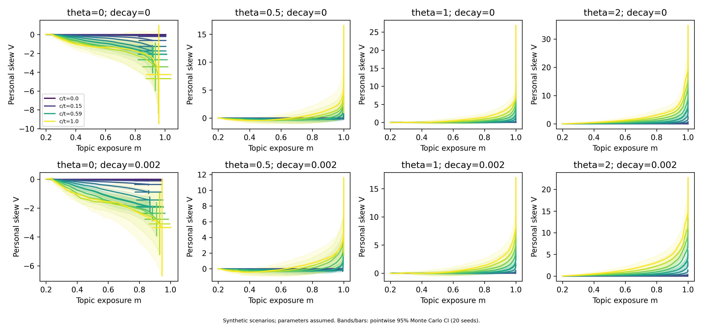
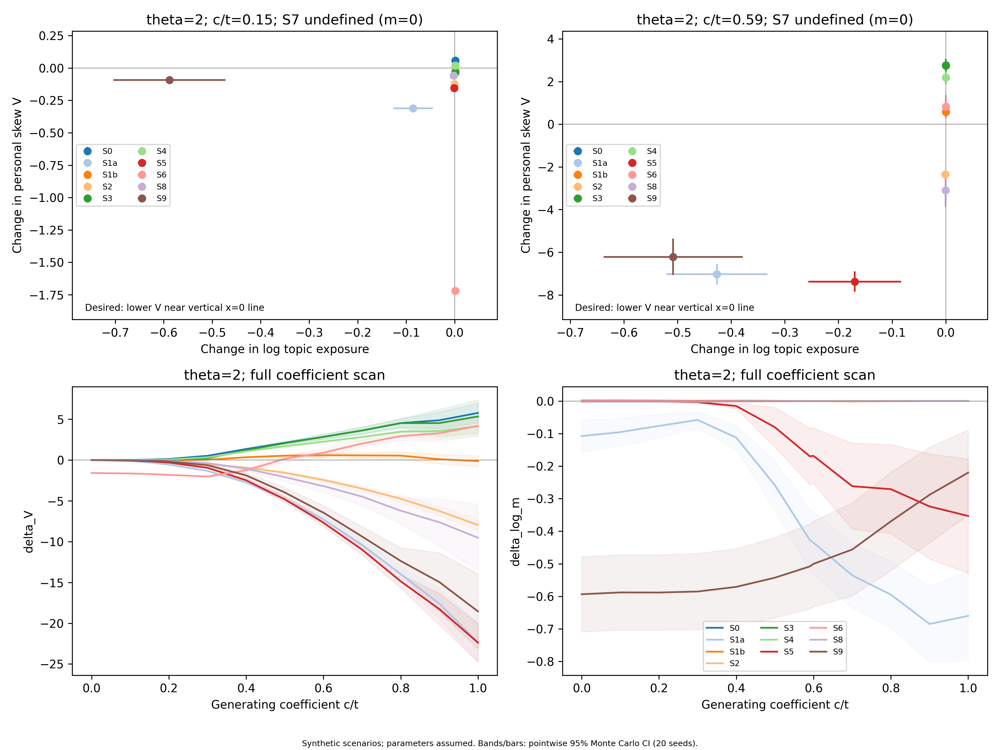
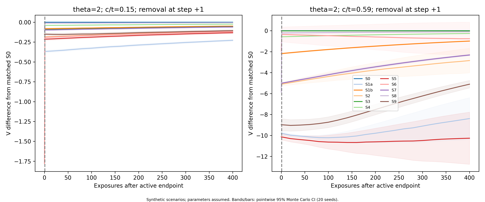
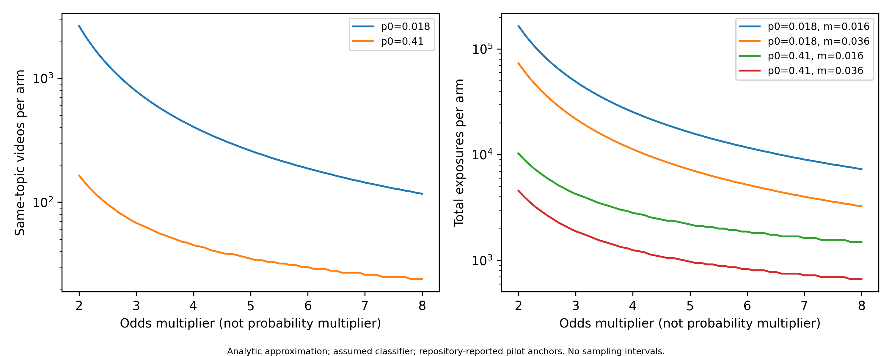

<!-- BEGIN XU RUICONG SIMULATION: preserve other authors' material outside these markers -->
## Transparent-model simulation and detectability

The synthetic experiments separate topic concentration from within-topic narrative skew. A softmax recommender samples item i with probability proportional to exp(u·v_i/τ). Target-topic items share a topic component t; A items have attribute component +c and B items −c. Four outside topics occupy separate orthogonal directions. Paired A/B items share nuisance vectors, so c=0 removes attribute contrast exactly. After exposure, completion occurs with probability σ(a+γ1[topic]+θ1[A]); completion adds ηv_i to the user vector, with exponential forgetting. We calculate exposure probabilities exactly at every step. These are scenarios, not estimated online-platform dynamics or changes in users' beliefs.

| Quantity | Value or scan | Evidence status |
|---|---|---|
| Catalogue and initial user | 40 A, 40 B, 320 outside items; d=8; u=0 | Assumed; initial topic share 20% and within-topic A share 50% |
| Topic structure | Four outside topics; one pooled outside topic as formation sensitivity | Assumed |
| Generating coefficients | t=1; c/t=0, 0.1, 0.15, 0.2, …, 0.5, 0.59, 0.6, …, 1 | Assumed sweep |
| Reported geometric anchors | Approximately 0.15 (group labels), 0.59 (conflict narrative) | Repository-reported Qwen3-Embedding pilot, v5 feasibility §3.4; not remeasured here |
| Completion model | a=−1, γ=1; θ=0, 0.5, 1, 2 | Assumed |
| Dynamics | η=0.05, τ=1; forgetting λ=0.002; formation also λ=0 | Assumed |
| Nuisance components | Two independent Gaussian coordinates, SD=0.05; paired within A/B | Assumed |
| Duration and replication | 600 formation steps; 200 intervention steps; 400 follow-up steps; 20 seeds | Assumed experimental design |
| Population reference | Four users per independent seeded world, one per θ; average exposure masses | Assumed population composition |
| Output filter | Recall 0.8, false-positive rate 0.02; outside-topic items unaffected | Assumed pending D3; expected thinning with refill |
| Detection anchors | p₀=1.8% or 41%; topic rate 1.6% or 3.6% | Repository-reported RecIF/LLM pilot values (v5 §4, §7 and Xu task R4), not validated population constants |

The generating ratio c/t is not the exposure-weighted contrast ratio c_j/t_j in Proposition 2. In this paired construction, attribute similarity differences depend quadratically on c; the numerical anchors therefore mark scenario locations, not a fitted recommender. Each seeded world computes p̄ from its mean A and B probability masses, rather than averaging users' conditional proportions. We report personal skew V=log(π(A)/π(B))−logit(p̄), platform amplification logit(p̄)−logit(p_sup), and their sum. Balanced synthetic supply gives p_sup=0.5. Formation uses a contemporaneous reference; intervention comparisons freeze the terminal formation reference. Pointwise 95% Monte Carlo intervals are mean ±2.093·SD/√20 across independent seeded worlds, not uncertainty about real platforms. Probability-scale intervals may extend outside [0,1]; stored values are not clipped.

### Formation

**Figure F-R2.** Synthetic formation trajectories in (m,V), for all 13 generating ratios, four preferences and two forgetting settings. Colours progress from c/t=0 to 1; the legend marks selected anchors. Bands show pointwise 95% Monte Carlo intervals for V, with endpoint intervals also shown for m. The plotted environment has four outside topics; the CSV additionally includes a single pooled outside topic.

At θ=2 and λ=0.002, c/t=0.15 reaches mean m=0.9984 while personal skew remains 0.0568 (95% interval 0.0440–0.0696). At c/t=0.59, m=0.9996 but V=4.829 (3.826–5.832). Topic concentration can thus be strong while narrative amplification remains weak; it does not establish a universal speed ordering. Completion preferences, representation geometry, forgetting and catalogue structure jointly determine the trajectory. Pooling all outside content into one direction can instead suppress the target topic through shared reinforcement. A neutral user's V can be negative because the population contains A-preferring users; this is not evidence that the neutral user has an explicit preference for B.

### Escape and persistence

We compare S0 (natural behaviour), S1a (−η on A), S1b (+0.5η on A), S2 (skip A), S3 (complete B), S4 (one extra completed B every ten exposures), S5 (delete surviving A contributions once), S6 (filter), S7 (remove all topic items), S8 (serve using the terminal population mean user vector), and S9 (reset once). Every strategy starts from the same formation state and uses coupled random draws. Deletion reverses only the remaining exponentially weighted A updates. Effort counts actions, with bulk deletion/reset counted once; filtering additionally records expected rejected mass. These counts are not comparable measures of human time or difficulty. Active search adds exposures and therefore also has an extra viewing cost.

**Figure F-R3.** Synthetic strategy effects at θ=2 after 200 active steps: Δlog m versus ΔV at the two anchor ratios, followed by the full ratio sweep. Bars/bands are pointwise 95% Monte Carlo intervals over 20 seeds. Desired outcomes lower V near Δlog m=0. S7 has m=0 and undefined V, so it is excluded from the plane. All four θ values remain available in the per-seed CSV and summary table.

There is no universally best strategy. At c/t=0.59, skipping A lowers V by 2.349 (95% interval −2.539 to −2.158 for ΔV), with mean Δlog m=−0.0007. Deleting A yields a larger reduction, ΔV=−7.376, but mean Δlog m=−0.170; negative NI yields −7.030 at a larger topic loss, −0.427. At c/t=0.15, deletion lowers V by 0.156 with mean Δlog m=−0.0011. These comparisons assume perfect knowledge of A for feedback/deletion and should not be interpreted as measured user-control effectiveness. Completing naturally encountered B can do little once B is rarely recommended; searching B helps relative to S0, but the assumed search rate need not reverse accumulated skew.

At c/t=0.59, S1b increases V by 0.577 while S1a decreases it by 7.030: their mean endpoint difference is 7.608 log-odds units. However, at c/t=0.15, S1b's mean ΔV is −0.0227. Its positive update can still be weaker than the natural completion it replaces, and forgetting also matters. The OneRec pilot reports a positive NI response about 78% of neutral mention (v5 §7 and Xu task R3); this response ratio is not an identified update coefficient. Our additional scan of −2, −1, −0.5, +0.25, +0.5, +0.78 and +1 times η is explicitly hypothetical. S8 also needs care: softmax of the mean user vector differs from mean softmax exposure, so this task-specified implementation need not make V exactly zero.

**Figure F-R3P.** Synthetic follow-up relative to matched S0. Step 0 retains the active intervention for endpoint measurement; output controls are removed before the next natural draw. Bands are pointwise 95% Monte Carlo intervals. All arms resume the original completion preference. S7 has no valid V at its active endpoint.

Output filtering loses its direct effect immediately on removal, although the history acquired while filtering can persist. History-changing strategies can leave longer effects; their size and rebound depend on subsequent behaviour. We record the first follow-up step at which the reduction relative to pre-intervention V halves, plus a separate half-life relative to matched S0. An intervention with no initial reduction has no defined rebound time; a reduction not halved within 400 steps is right-censored, not assigned a 400-step half-life. These are exponential-memory results, not a test of OneRec's finite history window.

### How much exposure is needed to notice skew?

For classifier recall α and false-positive rate β, observed prevalence is q=β+(α−β)p. We apply Proposition 4's independent, two-sample normal approximation, with one-sided significance 0.05, power 0.8 and equal-sized user/reference samples. An odds multiplier r implies p_u=rp₀/(1−p₀+rp₀), not rp₀. Each arm requires n≈(z₀.₉₅+z₀.₈)²[q_u(1−q_u)+q₀(1−q₀)]/[(α−β)²(p_u−p₀)²]. We round n upward and convert to total exposure using the assumed applicable topic rate.

**Figure F-R4.** Analytic scenario calculations for 2–8× odds, using α=0.8 and β=0.02. Left: same-topic videos per arm. Right: total exposures per arm using the repository's 1.6% median and 3.6% p90 topic-rate anchors. The CSV includes recall 0.7/0.9 and false-positive rate 0/0.05 sensitivity cases. These deterministic calculations have no seed-based confidence band.

At p₀=1.8% and 2× odds, each arm needs approximately 2,636 same-topic videos, or 164,750 total exposures at topic rate 1.6%. At 4× odds, these become 405 and 25,313. For p₀=41%, 2× odds needs 164 same-topic videos, or 10,250 total exposures at 1.6%. Two newly collected arms require twice these totals; an existing reference can change collection costs. Rare narratives are harder to detect even when their odds change substantially. Autocorrelation, uncertain classifier rates and an estimated reference can increase requirements. These are exposure counts, not elapsed time or a validated sequential alarm. A non-personalized reference measures personal deviation from that mode; it cannot establish absence of platform-wide amplification.

Per-seed results, summaries, scripts and provenance are in `analysis/v6_simulation/`. Both R1 self-checks pass: zero contrast yields zero V across all θ/seeds, and signed one-step updates agree with Proposition 2 with shrinking second-order error. The saved [run screenshot](../screenshots/ruicong_simulation_run.png) shows actual audit stdout opened in Notepad, not a simulated terminal. All findings remain conditional on the synthetic catalogue, assumed population, and uncalibrated completion and intervention mechanisms.
<!-- END XU RUICONG SIMULATION -->
