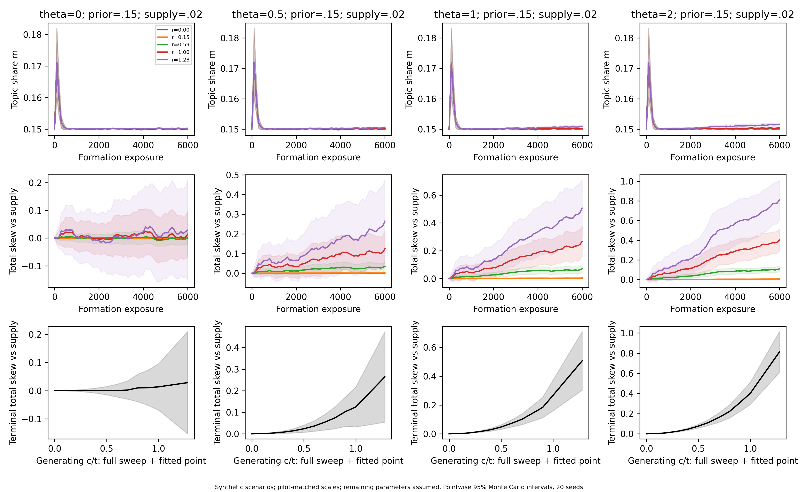
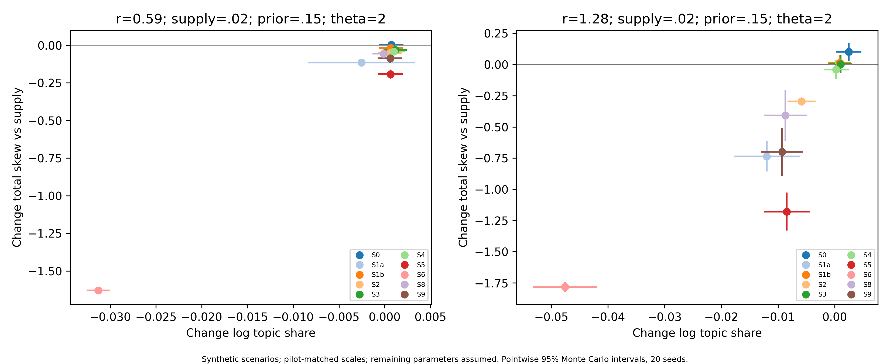
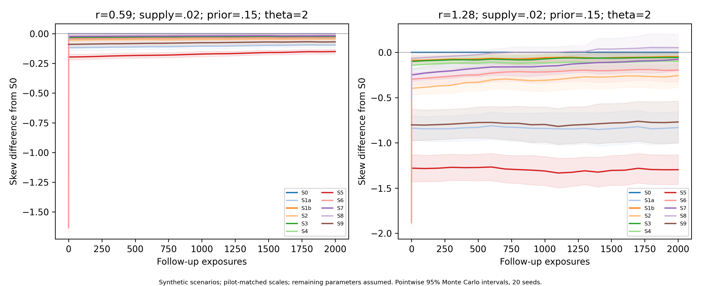

# 5 Case Study: Gender and Relationships (RQ2, RQ3)

<!-- 5.1 by Li Yitong, 2026-11-07. Sources: analysis/v5_feasibility/results/onerec_{probe,ni_header,viewpoint_ctrl}.json (v5 pilot, Qwen labels) and analysis/v6/results/l4_onerec_v0.json, l4_null.json (DeepSeek labels). 5.2 and 5.3 are Xu Ruicong's. -->

This section asks how a feed tilts and how a user can undo it, for the narrative of our case study: videos that attach a negative label to a whole gender ("group-label" videos, Section 4.3). We first measure how a recommender trained on real logs responds to user actions (5.1), then use those responses to set the scale of a transparent simulation of formation and escape (5.2), and finally ask whether a user could notice the tilt (5.3).

## 5.1 Measurements on OneRec

**Set-up (measured).** OneRec-1.7B is a recommender released by Kuaishou's team and trained on the RecIF logs (Zhou et al., 2025). It reads a user's history as text, with each video written as a three-part semantic ID, and generates the IDs of videos to recommend. We used it in two ways. In the *conditional* task, the history is split into sections (videos the user watched to the end, liked, marked "not interested", and so on); in the *video* task, it is one long sequence. For each of 30–50 users from the benchmark test set, whom the model never saw in training, we changed the history in one controlled way and computed the exact probability that the model recommends each video in a fixed candidate set. From these probabilities we read the two quantities of Section 3: the share of issue videos among the candidates (topic share $m$), and the log-odds of group-label videos against other issue videos of the same genre ($V$). Videos used to change the history were never among those used to measure the response.

**Result 1: the topic responds strongly.** Putting 10 issue videos in the "watched to the end" section raised the share of issue videos in the recommendations from 2.6% to 5.7%, against 2.8% when the 10 videos were off-issue; all 40 users moved in the same direction (pilot, Section 4 labels by Qwen). With issue labels from DeepSeek the effect has the same size: the log-odds of issue against off-issue candidates rose by 0.9–1.1, for 90–96% of 50 users.

**Result 2: "not interested" works in the wrong direction.** Putting the same 10 issue videos in the "not interested" section *also* raised the issue share, to 4.0% (40 of 40 users), and the marked videos themselves became more likely to be recommended. With DeepSeek-labelled videos the rise in log-odds was 0.33–0.45 for 96% of users, about 40% of the effect of the "watched" section. Swapping the section title showed why: three negative titles ("not interested", "disliked", "blocked") had almost the same effect as each other, about 78% of a neutral title ("here are some videos"). The model has learned that a video in the prompt is a clue to the user's interests, and has learned little about what the title means. A check on the logs ruled out the other explanation, that users mark only content they were already close to: in the logs, a "not interested" mark goes with *lower* later interest in the issue (odds 0.61–0.77 times). Sequence models trained only on logs are known to be insensitive to negative feedback (Y. Wang et al., 2023).

**Result 3: OneRec does not separate the group-label narrative from other issue videos.** We put 10 group-label videos (A) or 10 genre-matched other issue videos (B) in a section and compared $V$ on held-out videos. A positive difference means the model amplifies the narrative a user engages with. To rule out near-duplicates of the same story, injected and held-out videos never share a first-level semantic ID. As a null, we drew random "pseudo-narratives" of the same size and genre mix from videos without a group label and ran the same test.

**Table 5.1.** Response of $V$ (log-odds of A against B) to adding A rather than B to a user's history. Mean over users, standard error in brackets.

| A set (labels) | Users | "Watched" section | "Not interested" section | Video task, 20 appended |
|---|---:|---:|---:|---:|
| Group label, pilot (Qwen; 30 videos) | 30 | +1.13 (0.12) | +0.63 (0.07) | +1.43 (0.08) |
| Group label (DeepSeek; 171 videos) | 50 | +0.12 (0.07) | +0.06 (0.05) | −0.11 (0.07) |
| Random pseudo-narrative, one draw | 50 | +0.19 (0.04) | +0.08 (0.03) | +0.15 (0.08) |
| Random pseudo-narratives, 10 draws: mean (SD across draws) | 30 | +0.09 (0.13) | +0.02 (0.09) | — |

With the reference labels, the group-label contrast is small and inside the range of random pseudo-narratives (−0.18 to +0.24 for the "watched" section over 10 draws). The spread across random sets is larger than the standard error within one set, so a single set must be compared with that spread, not with zero. The large pilot value came from a set of 30 videos labelled by the open model, whose positive labels the reference model confirms only about one time in ten (Section 4.3); a small set of such videos can differ from the rest in ways other than the narrative. We therefore treat OneRec's attribute contrast for this narrative as approximately zero, and the pilot value as an upper scenario.

**What this means.** By Proposition 1, the same contrast drives both formation and escape. For this narrative and this model, a user's own clicks would do little to build a personal tilt, and the user's own feedback would do little to remove one; what the model does respond to is the topic. A tilt of the kind Section 3 defines would then come mostly from the platform layer or from a recommender whose representation separates the narrative more finely than OneRec's text-derived IDs. Section 5.2 therefore reports the whole range of contrasts, from the measured value near zero to the pilot value. "Not interested", by contrast, behaves in the wrong direction at every level we measured, so a user who marks group-label videos as not interested raises their issue share and gains nothing on the mix.

These are measurements on one open model of one platform's data, not on the app itself (Section 7.3).

<!-- BEGIN XU RUICONG SIMULATION: material outside these markers belongs to other authors -->
## 5.2 Simulation: formation and escape

The pilot-matched scenarios show narrative skew growing while topic exposure stays similar. Controls differ in their effectiveness and collateral cost; these are conditional simulation results, not measured online-platform or belief changes.

We represent target-narrative videos A, other within-topic videos B, and four outside topics as six homogeneous groups. Recommendation is weighted softmax, π(i) ∝ wᵢ exp(u·vᵢ/τ). A/B share topic coordinate t and have supply-centred attribute coordinates c(1−s)/−cs, where s is A's supply share. Completion probability is σ(−1+1[topic]+θ1[A]); completion updates u, with forgetting and coordinatewise clipping. We calculate topic exposure m exactly. V_sup=log(π(A)/π(B))−log(s/(1−s)) is the **total skew of Section 3.2**, not personal skew relative to a platform population. Twenty seeds give pointwise 95% Monte Carlo intervals for means. Full methods and parameters are in [Appendix B](../../report/sections/12_appendix_b.md).

| Quantity | Main values and sensitivity | Evidence status |
|---|---|---|
| Injection targets | Topic +0.70; attribute +1.13/+0.65; NI response 78%; each target ±50% separately | Uncertain v5 OneRec pilot anchors; attribute labels were Qwen-based |
| Interest and supply | Initial topic 10%/15%/20%; A supply 2%/10%/50%; main .15/.02 | Assumed heavy-viewer scenarios, not supply estimates from exposure |
| Representation | c/t=0–1 plus .15/.59 and fitted 1.280/.971; η=τ=1 fixes units | Moment fit identifies only ηt²/τ and ηc²/τ |
| Response and memory | θ=0/.5/1/2; forgetting .0002, with .002 sensitivity; coordinate caps | Assumed; not OneRec's identified memory |
| Duration and replication | 6,000 formation, 1,000 active, 2,000 follow-up exposures; 20 seeds | Assumed design; counts are not elapsed time |
| Filtering | Benchmark recall/FPR .8/.02; v2 sensitivity .8/.1253 | Benchmark assumed; v2 is cross-model agreement, not gold-standard accuracy |

### Formation

Stronger attribute contrast permits substantial skew without losing the topic. At θ=2, main-scenario terminal V_sup is .0061 at c/t=.15, .1094 at .59, and .8120 at the fitted ratio (95% interval .6088–1.0152); mean m is .1516. Neutral-user skew is consistent with zero. The stable topic plateau partly follows from the clipping policy, not validated platform stability. Calibration reproduces pilot injection contrasts rather than actual OneRec histories; Qwen-labelled targets may be biased and need replacement by the forthcoming L4 replication.

**Figure F-R3-formation.** Synthetic group-label scenarios, supply .02 and prior .15. Time panels show selected ratios; the last row shows the full coefficient sweep. Bands are pointwise 95% Monte Carlo intervals.

### Escape

Ideal deletion and filtering produce the largest reductions, but their costs and assumptions differ. Arms are S0 natural behaviour; S1a negative NI/S1b positive-.5 NI; S2 skip A; S3 complete B; S4 search B; S5 delete surviving A contributions; S6 filter; S7 remove the topic; S8 serve the mean user state; S9 reset. Effort is not matched across arms; deletion assumes perfect labels and counts one bulk action.

At the fitted group-label ratio, S1a changes skew by −.7364 and S1b by +.0140; their paired difference is .7504 (95% interval .5991–.9018). A separate fit of the 78% NI response gives coefficient .7706 and skew change +.1098. Deletion reduces skew by 1.1788 with Δlog m=−.0084, versus 1.7833/−.0476 for benchmark filtering. A v2-classifier main-case rerun gives −1.6551/−.1453: filtering still lowers skew, but loses more topic exposure. This supplements, rather than replaces, the full-grid benchmark.

S3 does not reverse accumulated skew: ΔV_sup≈+.002, compared with +.102 under S0. Proposition 1 predicts a negative **local** B effect, but its contrast is −c²s versus c²(1−s) for A. At 2% supply, each B update carries only about 1/49 of A's attribute signal. Continued A feedback, clipping and forgetting limit cumulative escape. Ordinary B content is not a strongly opposed counter-narrative.

**Figure F-R3-escape.** Synthetic main-case endpoint effects at θ=2. Bars are pointwise 95% intervals. S7 has m=0 and undefined skew, so it is omitted. Filtering here uses the assumed benchmark classifier.

### Persistence

Output controls lose their direct effect on removal, while changed histories can persist. Both pre-intervention rebound and improvement relative to matched S0 are recorded. No initial improvement has an undefined half-life; improvement not halved within 2,000 follow-up exposures is right-censored. In the fitted main case, all 20 deletion runs improve over S0 initially and all remain censored; this is not an observed 2,000-exposure half-life or a claim about OneRec's finite history.

**Figure F-R3-persistence.** Difference from matched S0 after stopping. Output controls are removed before the first natural follow-up draw; preferences resume unchanged. Bands are pointwise 95% intervals.

## 5.3 Detectability

Rare-narrative detection is demanding, and false positives can overwhelm the signal. We use Proposition 6's independent two-arm approximation at significance .05 and power .8. With the v2 reference prevalence 1.0% and twice the odds, the assumed classifier needs 6,475 same-topic videos per arm, or 404,688 total exposures at topic rate 1.6%. The v2 Qwen error profile raises these to 33,070 and 2,066,875. Two newly collected arms double the totals.

**Figure F-R4-revised.** Deterministic 2–8× odds scenarios. Left: v2 and historical prevalence anchors. Right: v2 under the assumed and Qwen-cross-check classifiers, at topic rates 1.6%/3.6%. There is no seed-based confidence band.

The cross-check has 62 false positives against four true positives relative to DeepSeek. At that error profile, ordinary personal histories provide far too little evidence for reliable detection in this scenario; this does not establish universal impossibility for open-source classifiers. Only five reference-positive samples support recall estimation, model agreement is not gold-standard accuracy, and rate uncertainty/autocorrelation are not propagated. A nonpersonalized reference also cannot reveal all platform-wide amplification.

All seed endpoints, summaries, compressed numeric files and provenance are retained. The [runtime screenshot](../screenshots/ruicong_calibrated_run.png) shows actual audit output. Appendix B documents the model, filtering convention (Proposition 3), calibration limits, censoring and reproduction.
<!-- END XU RUICONG SIMULATION -->
