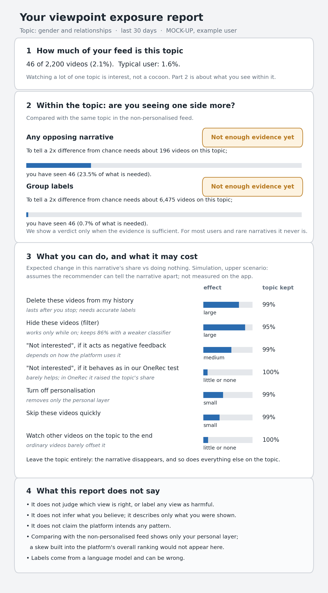

# 6 Design Implications: A Viewpoint Exposure Report

<!-- D6 draft, Zhao Dingcheng, 2026-11-07. Figure generated by analysis/v6_annotation/design_mockup.py; every number on it is listed with its kind (illustrative / formula / simulation) in analysis/v6_annotation/results/exposure_report_mockup.csv. -->

What should a tool that helps users see a viewpoint cocoon show, and what must it refuse to claim? Chinese platforms' "cocoon self-assessments" summarise a feed by content categories, which Proposition 2 shows cannot reveal within-topic skew. Earlier tools that showed users the balance of their reading changed behaviour a little (Munson et al., 2013) and raised awareness of the filter bubble (Nagulendra & Vassileva, 2014). Figure 6.1 turns our results into a mock-up of a user-side *viewpoint exposure report*. It is a design sketch: the example user is invented and no user study was run.

**Figure 6.1.** Mock-up of a viewpoint exposure report for one topic. The example is a heavy user; the median RecIF user saw about 8 marriage videos in their whole history. The user's numbers (part 1) are invented, the evidence thresholds (part 2) come from Proposition 6, and the effects (part 3) are synthetic results from the main simulation case in Section 5.2, relative to doing nothing. That case uses the pilot attribute contrast, which Section 5.1 treats as an upper scenario; none of these effects was measured on Kuaishou.

**Part 1 keeps interest apart from skew.** The report shows how much of the feed the topic takes up, next to what is typical, and says that watching a lot of one topic is interest, not a cocoon. Our state $(m, V)$ separates the two because they call for different responses; a report that shows topic share alone invites the wrong conclusion.

**Part 2 compares with a reference and says when it cannot tell.** The within-topic mix is compared with the same topic in the non-personalised feed, the reference a user can actually obtain, and a verdict is shown only when the evidence suffices. With the classifier assumed in Section 5.3, detecting a doubling of the odds needs about 196 topic videos for opposing narratives in general (about one in five gender-and-relationships impressions, Table 4.1) and about 6,475 for gender group labels at the 1% rate in Table 4.2. Even the heavy user in the example has seen 46. For rare narratives, the honest answer from a user-side tool is almost always "not enough evidence yet": users cannot be expected to notice such a skew, and sampling their feed cannot do it for them. Only the platform, which knows exposure probabilities, can compute the comparison without sampling.

**Part 3 lists actions with their expected effect and cost.** Each action's effect on the target narrative is shown next to how much of the topic it keeps. Deleting the narrative from one's history has a large effect that lasts after the user stops; offering deletion by narrative, not only by video or topic, would make this practical. A filter has the largest effect but works only while it is on, and with a weaker classifier it removes more of the topic (95% kept with the benchmark classifier, 86% with the open model's error rates). "Not interested" helps only if the platform treats it as negative feedback; in our OneRec measurements it instead raised the topic's share and left the mix unchanged. Watching other videos on the topic barely offsets the skew, and turning off personalisation removes only the personal layer (Proposition 5). All of these effects assume the recommender can tell the narrative apart. OneRec, measured with reference labels, barely can (Section 5.1); for such a recommender, actions that work through the user's history would change the mix little, and only a filter, which acts on the output, would still work.

**Part 4 states what the report does not claim.** It does not judge which view is right, infer what the user believes, or attribute intent to the platform. It also names the blind spot of its reference: comparing with the non-personalised feed reveals only the personal layer, so a skew built into the platform's overall ranking would not appear (Section 3.2) and needs outside audits.

The thresholds assume a classifier more accurate than the open model, the action effects come from one calibrated scenario, and how users would read such a report is untested.
